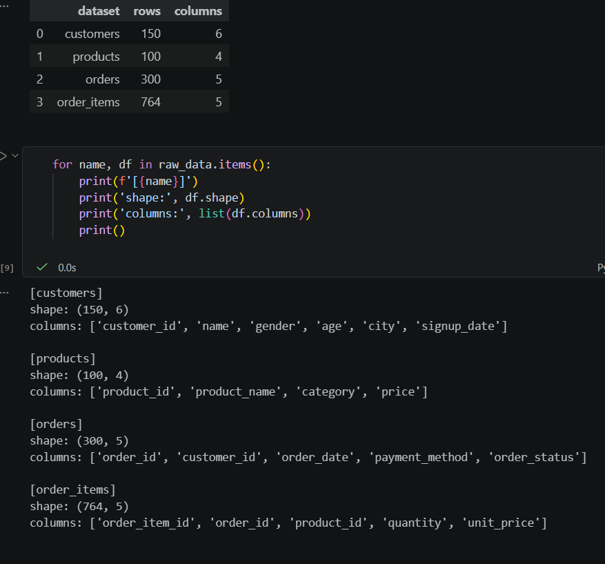
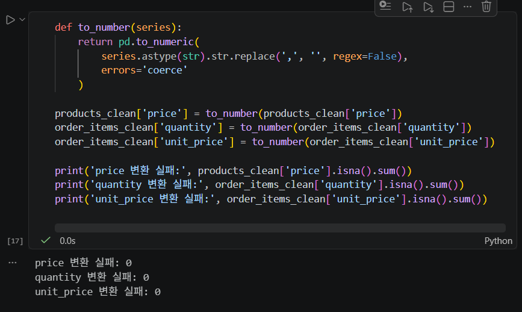
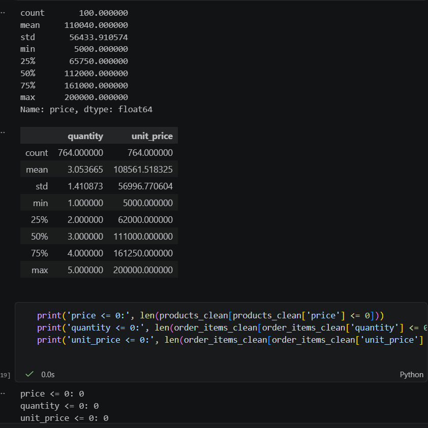
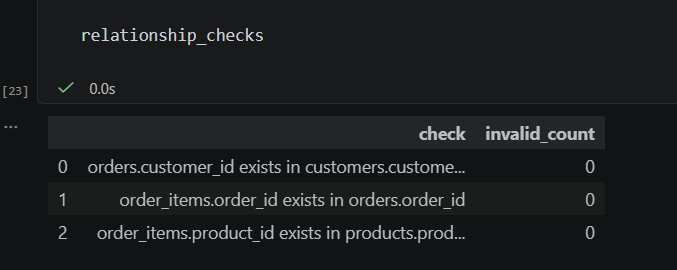
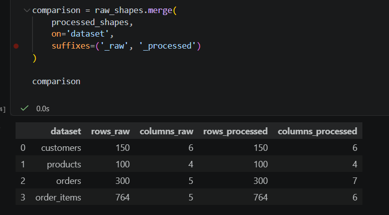
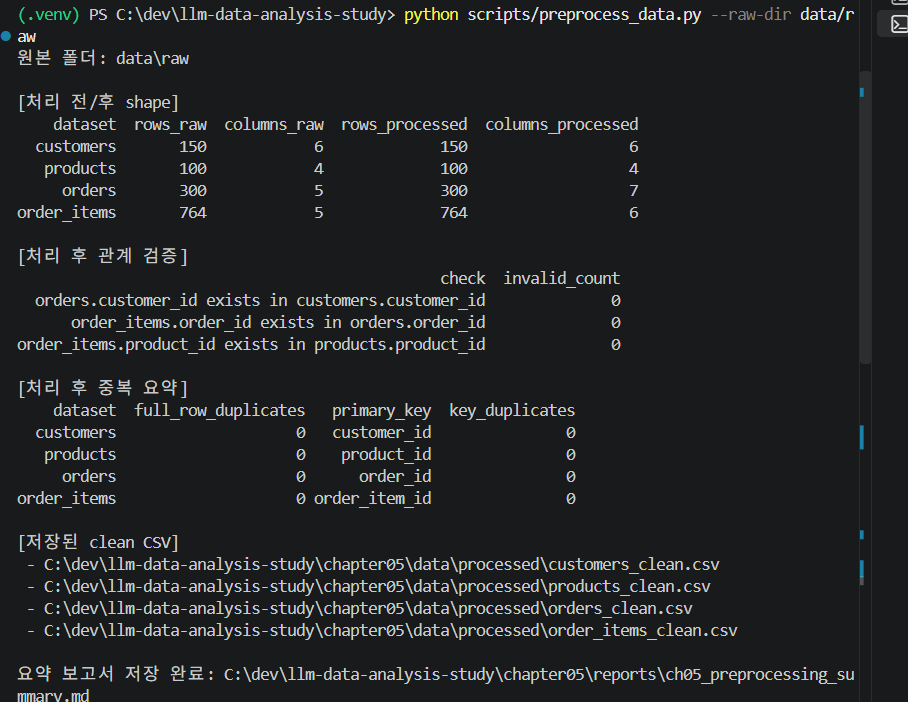

# Chapter 05 제출 답안 양식. 분석을 믿을 수 있게 만드는 데이터 전처리

> 주 제출물은 실행 완료 Notebook `chapter05/chapter05.ipynb`입니다. 이 양식의 항목을 Notebook의 Markdown 셀로 추가해 작성합니다.

## 0. 제출 정보
- 이름: 황지원
- GitHub ID: Jiwon0712
- 작성일:2026-10-10
- 최종 제출 URL: 

## 1. 전처리 전 상태 기록
- 각 데이터 shape: customers (150,6), products (100,4), orders (300,5), order_items (764, 5)
- 결측치: customers, products, orders, order_items 전부 0건
- 전체 중복: customers, products, orders, order_items 전체 행 중복 0건
- 주요 ID 중복: 
customers customer_id 중복 수: 0
products product_id 중복 수: 0
orders order_id 중복 수: 0
order_items order_item_id 중복 수: 0
- 타입 문제 후보: 
customers. signup_date : str -> datetime 변환 필요
orders.order_date: str -> datetime 변환 필요
customer_id, product_id, order_id, order_item_idL int64. 합계/평균 대상에서 제외
customers.gender, customers.city, products.category, orders.payment_method, orders.order_status(범주형): str로 문제는 x, 고유값이 적어서 카테고리 변환 검토해보기.

### 결과 관찰
- 4개 테이블(customers 150행, products 100행, orders 300행, order_items 764행) 모두 결측치가 0건이고, 전체 행 중복과 주요 ID(customer_id, product_id, order_id, order_item_id) 중복도 0건이다.
- 값의 누락이나 중복 때문에 생기는 문제는 없고, 데이터 타입 문제만 확인하면 된다.
- 날짜 컬럼(customers.signup_date, orders.order_date)이 str 타입이라 datetime 변환이 필요하다.
- ID 컬럼(customer_id, product_id, order_id, order_item_id)이 int64라서 합계나 평균 같은 수치 집계에서 실수로 포함될 수 있다.
- 범주형 후보 컬럼(customers.gender, customers.city, products.category, orders.payment_method, orders.order_status)은 str 타입이다. 고유값 수가 적어 category 타입으로 바꾸기 좋다.

### 나의 해석과 판단
어떤 문제를 먼저 처리해야 하는지와 이유를 작성하세요.

- 가장 먼저 처리할 문제는 날짜 컬럼의 datetime 변환이다. 
- 이유: 날짜가 문자열이면  월별/요일별 주문 추이, 가입 시점 기준 코호트, 가입일과 주문일 간격 계산 같은 시계열 분석이 불가능하거나 정렬 오류가 생길 수 있다. 이후 분석 대부분이 이 변환에 의존한다. 또 결측치와 중복이 없으므로 데이터 정제 단계에서 제거하거나 보정할 대상이 없다. 

### 업무·분석적 의미
- 결측과 중복이 없어서 행 수가 줄지 않는다. 전처리 후에도 분석 모수가 그대로 유지되어 결과를 믿을 수 있다.
- 날짜를 datetime으로 바꾸면 매출 추이, 신규 가입 추이, 가입 후 첫 주문까지의 기간처럼 마케팅·운영에서 자주 쓰는 지표를 만들 수 있다.
- ID를 수치 집계에서 제외하면 의미 없는 통계값이 리포트에 섞이는 것을 막는다.
- 범주형을 정리해 두면 결제수단별, 지역별, 카테고리별, 주문상태별 비교를 일관되게 할 수 있다.

### 한계와 추가 확인 사항
- 결측치가 0건이라는 것은 NaN이 없다는 뜻일 뿐이다. "unknown", "-", 빈 문자열 같은 숨은 결측치가 있는지 확인해야 한다.
- 이상치는 아직 확인하지 않았다.
- 범주형 컬럼들의 표기 불일치를 고유값 목록으로 확인해야 한다.
- 테이블 간 참조 무결성을 확인해야 한다. 
- 날짜 범위가 타당한지 확인해야 한다.
- order_items의 금액이 products 가격이나 orders 합계와 일치하는지 아직 확인하지 않았다.

## 2. 문자열·타입·결측 처리
- 적용한 문자열 정리: 4개 테이블(customers, products, orders, order_items)의 문자열 컬럼 전체에 앞뒤 공백 제거를 적용했다. orders의 order_status 컬럼은 매핑 딕셔너리로 `complete/Complete/COMPLETED/완료`, `cancel/Cancel/CANCELLED/취소`, `refund/Refund/REFUNDED/환불`을 `completed/cancelled/refunded` 3개 값으로 통일했다. 숫자 컬럼은 변환 전에 천 단위 쉼표를 제거했다.
- 숫자 변환 대상과 실패 건수: 대상은 products의 price 컬럼, order_items의 quantity 컬럼, order_items의 unit_price 컬럼이고, 실패 건수는 각각 0건, 0건, 0건이다. 
- 날짜 변환 대상과 실패 건수: 대상은 customers의 signup_date 컬럼, orders의 order_date 컬럼이고, 실패 건수는 각각 0건, 0건이다. 
- 결측 처리 기준: 전처리 전 결측치가 0건이었고 변환 실패도 0건이라 새로 생긴 결측이 없다. 따라서 행 삭제나 값 대체는 하지 않았다. 

### 결과 관찰
- 4개 테이블의 문자열 컬럼에 앞뒤 공백 제거가 오류 없이 완료되었다. 실행 중 pandas 경고(`select_dtypes(include='object')` 관련)가 출력되었지만 결과에는 영향이 없다.
- city 상위 10개는 성남 21, 광주 17, 부산 16, 대구 15, 서울 15, 울산 14, 인천 14, 대전 14, 수원 13, 고양 11건이며, 표기가 갈라진 값은 보이지 않는다.
- order_status는 매핑 전후 모두 completed 184, cancelled 64, refunded 52건으로 같다. 합계는 300건으로 orders 행 수와 일치한다. 매핑으로 바뀐 값은 없었고, 처음부터 표준 표기였다.
- price, quantity, unit_price의 숫자 변환 실패는 모두 0건이다.
- signup_date와 order_date의 날짜 변환 실패는 모두 0건이다. 주문 기간은 2025-09-18부터 2026-09-17까지이고, 파생 컬럼 order_month와 order_dayofweek를 생성했다.

### 나의 해석과 판단
왜 해당 처리 방식을 선택했는지 작성하세요. 삭제/대체가 정보 손실을 만들 가능성도 설명하세요.

공백 제거, 표기 통일 매핑, `errors='coerce'` 변환 후 실패 건수 확인의 순서로 처리했고, 삭제와 대체는 하지 않았다.
- 공백 제거: "서울"과 "서울 "처럼 의미는 같은데 다른 값으로 집계되는 문제를 막는다. 값의 의미가 바뀌지 않으므로 정보 손실이 없다.
- 표기 통일 매핑: 상태값이 섞여 있으면 같은 상태가 따로 집계된다. 이번 데이터는 이미 표준 표기여서 바뀐 값이 없었지만, 이후 데이터가 들어와도 안전하도록 적용했다. 여러 표기가 하나로 합쳐지므로 원래 표기 구분은 사라지지만, 의미가 같은 값이라 분석에는 문제가 없다. 매핑에 없는 값은 그대로 남기 때문에 value_counts로 3개 값만 남았는지 확인했다.
- coerce 변환: 변환할 수 없는 값을 NaN/NaT로 바꾸면 원본 값이 사라져 정보 손실이 생길 수 있다. 그래서 변환 직후 실패 건수를 확인했고, 이번에는 모두 0건이라 손실이 없었다.
- 삭제/대체 미적용: 결측이 없어서 적용할 대상이 없다. 행을 삭제하면 모수가 줄고, 평균 등으로 대체하면 분포가 왜곡될 수 있으므로 필요할 때만 쓴다.

### 업무·분석적 의미
- 날짜가 datetime으로 바뀌어 월별/요일별 주문 분석을 바로 할 수 있다.
- price, quantity, unit_price가 숫자형이라 매출 같은 금액 집계를 계산할 수 있다.
- 취소 64건과 환불 52건은 전체 주문의 약 39%를 차지한다. 매출 집계에 completed만 포함할지 먼저 정의해야 지표가 왜곡되지 않는다.
- 문자열이 정리되어 지역별/상태별 집계와 테이블 조인의 신뢰도가 높아진다.

### 한계와 추가 확인 사항
- 변환에 성공했다는 것이 값이 타당하다는 뜻은 아니다. 음수 가격, 0 이하 수량, 비정상적으로 큰 금액 같은 이상치는 아직 확인하지 않았다.
- signup_date는 head 5건만 확인했다. 최솟값과 최댓값, 미래 날짜 여부, 가입일보다 앞선 주문일이 있는지 확인해야 한다.
- city는 상위 10개만 확인했다. 전체 고유값과 gender, products.category, payment_method의 고유값도 확인해야 한다.
- 공백 제거는 앞뒤만 처리한다. 문자열 중간의 공백이나 특수문자 같은 숨은 결측치는 남아 있을 수 있다.
- 쉼표 제거는 쉼표가 천 단위 구분자라는 가정에 기댄다. 다른 의미의 쉼표가 있으면 값이 잘못 합쳐질 수 있다.
- pandas 경고는 `include=['object', 'string']`으로 바꾸면 해소할 수 있다.

## 3. 중복·범주 표준화·이상값 후보
- 제거/보류한 중복: 제거한 중복은 없다. 전처리 전 확인 단계에서 4개 테이블의 전체 행 중복과 주요 ID 중복이 모두 0건.
- 표준화한 범주값: orders 테이블의 order_status 컬럼을 completed / cancelled / refunded 3개 값으로 통일했다. 이번 데이터는 이미 표준 표기여서 바뀐 값은 없었다.
- 허용값 밖 값: price ≤ 0은 0건, quantity ≤ 0은 0건, unit_price ≤ 0은 0건이다. 허용 기준은 세 컬럼 모두 0보다 큰 값이다.
- 이상값 후보: 허용값 밖 값은 없었다. `describe()` 기준으로 price는 5,000~200,000, unit_price는 5,000~200,000, quantity는 1~5 범위이고, 극단적으로 튀는 값은 보이지 않는다. 필터 적용 후 products (100, 4), order_items (764, 5)로 행 수가 그대로여서 제외된 행은 없다

### 결과 관찰
- price는 평균 110,040, 중앙값 112,000, 최솟값 5,000, 최댓값 200,000이다.
- unit_price는 평균 약 108,562, 중앙값 111,000, 최솟값 5,000, 최댓값 200,000이다. products의 price 컬럼과 범위가 같다.
- quantity는 평균 약 3.05, 중앙값 3, 최솟값 1, 최댓값 5이다. 값이 1~5 사이에 모여 있다.
- 세 컬럼 모두 0 이하 값이 0건이라 `> 0` 필터를 적용해도 행이 줄지 않았다.
- `describe()` 값으로 IQR 기준(Q1 − 1.5×IQR, Q3 + 1.5×IQR)을 계산해 보면 세 컬럼 모두 최솟값·최댓값이 경계 안에 있다. price 상한 경계는 약 303,875, unit_price는 약 310,125, quantity는 −1~7이다. 통계적 이상치 후보도 없다.

### 나의 해석과 판단
이상값을 자동 삭제하지 않고 후보로 검토해야 하는 이유를 작성하세요.

- 값이 통계적으로 크거나 작다고 해서 오류인 것은 아니다. 고가 상품이나 대량 주문처럼 실제로 발생한 정상 거래일 수 있다. 자동으로 지우면 실제 매출이 제외될 수 있다.
- 이상값이 입력 오류인지 실제 값인지는 데이터만으로 판단하기 어렵고 원본 시스템이나 담당자 확인이 필요하다. 먼저 후보로 남겨 두고 확인한 뒤 처리해야 한다.
- 행을 삭제하면 분석 모수가 줄고, 같은 주문의 다른 컬럼 정보까지 함께 사라진다. 삭제는 되돌리기 어려우므로 근거가 확인된 뒤에 하는 것이 안전하다.
- 따라서 이번 데이터에서는 0 이하 값(허용값 밖)과 IQR 기준 이상치 후보가 모두 없어서 삭제나 보정은 하지 않았다. `> 0` 필터는 실습용 기준으로 적용했고, 실제 업무라면 적용 전에 담당자 확인이 필요하다.

### 업무·분석적 의미
- 가격과 수량에 비정상 값이 없어 매출 집계 결과를 신뢰할 수 있다.
- 행이 줄지 않아 이후 분석의 모수가 그대로 유지된다.
- order_status 컬럼이 3개 값으로 정리되어 상태별 집계가 일관된다.
- 중복이 없어서 주문과 주문 상세의 건수가 부풀려지지 않는다.

### 한계와 추가 확인 사항
- 허용값 기준이 0 초과뿐이다. 수량이나 단가의 상한은 정의하지 않았다. quantity 1~5가 업무 규칙상 정상 범위인지는 별도로 확인해야 한다.
- 이상값 검사는 products의 price 컬럼, order_items의 quantity 컬럼, order_items의 unit_price 컬럼에만 했다. 다른 수치 컬럼이 있는지 추가 확인하지 못했다.
- order_items의 unit_price 컬럼이  products의 price 컬럼과 일치하는지, 같은 상품의 단가가 주문마다 다른지는 확인하지 않았다.
- quantity에 소수 같은 비정수 값이 있는지는 `describe()`만으로는 알 수 없다.
- 중복 확인은 문자열 정리 전 기준이다. 공백 제거와 표기 통일 이후에 중복이 새로 생겼는지 추가로 확인하는 것이 좋다. 
- gender, products의 category, payment_method 컬럼의 표기 표준화는 이미지에서 확인하지 못했다.
- IQR 계산은 `describe()` 값으로 직접 한 것이며, 노트북에서 별도 이상치 검사를 실행한 결과는 아니다.

## 4. PK/FK와 파생 컬럼 재검증
- 없는 `customer_id`: 0건 
- 없는 `order_id`: 0건
- 없는 `product_id`: 0건
- 생성한 파생 컬럼: `line_total` (= `quantity` × `unit_price`)를 order_items_clean에 생성했다. 주문 상세 한 줄의 금액이다.
- `line_total` 검증: 상위 5행에서 quantity × unit_price와 line_total이 모두 일치했다(3×102,000=306,000, 5×25,000=125,000, 3×142,000=426,000, 3×193,000=579,000, 4×189,000=756,000). 전처리 후 line_total 전체 합계는 255,610,000이다.

### 결과 관찰
- 관계 검증 3건(orders/customers, order_items/orders, order_items/products)의 invalid_count가 모두 0이다. 전처리 후 기준으로 고아 행은 없다.
- line_total은 `quantity * unit_price`로 계산했고 상위 5행의 값이 수식과 일치한다.
- 전처리 후 line_total 합계는 255,610,000이다. 764행으로 나누면 행당 평균 약 334,568이다. 이는 앞 단계 `describe()`의 quantity 평균(약 3.05)과 unit_price 평균(약 108,562)을 곱한 값(약 331,000)과 비슷한 수준이다.

### 나의 해석과 판단
전처리 후 관계를 다시 검증해야 하는 이유를 작성하세요.
- 전처리는 값을 바꾸거나 행을 지우는 작업이다. 공백 제거, 타입 변환, `> 0` 필터 같은 처리가 키 값을 바꾸거나 부모 행을 없애면 조인이 끊길 수 있다. 처리 후 결과를 기준으로 확인해야 이후 분석이 안전하다.
- 관계가 깨져 있으면 조인 시 행이 사라지거나 NaN이 생겨 매출과 고객별 집계가 틀어진다. 파생 컬럼 line_total도 정리된 quantity, unit_price에 의존하므로 같이 검증해야 한다.
- 이번 결과에서는 고아 키가 0건이고 필터 전후 행 수가 같아 전처리로 관계가 손상되지 않았다고 볼 수 있다.

## 5. 전처리 전/후 비교
| 항목 | 처리 전 | 처리 후 | 변화 이유 |
| 행 수 | customers 150 / products 100 / orders 300 / order_items 764 | customers 150 / products 100 / orders 300 / order_items 764 | 결측, 중복, 0 이하 값이 없어 삭제한 행이 없다. `> 0` 필터를 적용했지만 제외된 행도 없다. |
| 열 수 | customers 6 / products 4 / orders 5 / order_items 5 | customers 6 / products 4 / orders 7 / order_items 6 | 파생 컬럼 추가: orders에 order_month, order_dayofweek(+2), order_items에 line_total(+1) |
| 결측 | 4개 테이블 모두 0건 | 0건 (변환 실패 0건 기준) | 원래 결측이 없었고, 변환 실패(NaN/NaT)로 새로 생긴 결측도 없다. 삭제나 대체는 하지 않았다. |
| 중복 | 0건 (전체 행, 주요 ID) | 재확인 안 함 (행 수 변화 없음) | 제거한 중복이 없다. 공백 제거와 표기 통일 이후의 중복 재확인은 하지 않았다. |
| 변환 실패 | 해당 없음 (변환 전) | 0건 (price, quantity, unit_price, signup_date, order_date 모두) | `errors='coerce'` 변환 후 실패 건수를 확인했고 모두 0건이다. |

### 결과 관찰
- 4개 테이블 모두 처리 전후 행 수가 같다. 합계는 1,314행에서 1,314행이다.
- customers와 products는 열 수도 처리 전후 동일하다. 데이터 타입만 바뀌었다.
- orders는 5열에서 7열, order_items는 5열에서 6열로 늘었다. 증가한 열은 모두 파생 컬럼이다.
- order_status는 표기 통일 매핑 전후 건수가 같다(completed 184, cancelled 64, refunded 52).
- 변환 실패는 숫자 3개 컬럼과 날짜 2개 컬럼 모두 0건이다.

### 나의 해석과 판단
행 수나 값 분포 변화가 의도한 결과인지 판단한 근거를 작성하세요.

행 수가 그대로인 것은 의도한 결과라고 판단했다.
- 1단계에서 결측과 중복이 0건이었고, 3단계에서 0 이하 값도 0건이었다. 삭제 대상이 없으므로 행 수가 같아야 정상이다. 만약 줄었다면 어떤 규칙이 행을 지웠는지 추적해야 했다.
- 늘어난 열은 order_month, order_dayofweek, line_total이다. 모두 분석을 위해 의도적으로 만든 파생 컬럼이고, 원본 컬럼은 삭제하지 않았다.
- 전처리는 타입 변환(문자열→날짜/숫자)과 공백 제거가 중심이었다. 표기 통일 매핑으로도 건수가 바뀌지 않았다. 따라서 값 분포가 달라질 만한 처리는 없었다고 판단했다.

### 업무·분석적 의미
- 분석 모수가 처리 전과 같아서 처리 후 지표를 원본 데이터와 같은 기준으로 비교할 수 있다.
- 파생 컬럼 덕분에 월별/요일별 주문 분석과 주문 상세 금액 집계를 바로 진행할 수 있다.
- 이번 결과는 정리할 문제가 적은 데이터라는 뜻이다. 실제 업무 데이터에서는 행 수가 줄거나 결측이 생기는 경우가 많아서, 이 비교표로 처리 영향 범위를 기록해 두는 것이 중요하다.

### 한계와 추가 확인 사항
- 처리 후 결측과 중복은 비교 이미지에서 직접 확인한 값이 아니다. 결측은 변환 실패 0건과 행 수 불변으로 추정했고, 중복은 재확인하지 않았다. 전처리 후 `isna().sum()`과 `duplicated().sum()`을 다시 실행해 채우는 것이 안전하다.
- 행 수와 열 수만 비교했다. 컬럼별로 평균이나 고유값의 수 전후 비교는 하지 않았다.
- 처리 전 `describe()`가 없어서 price, quantity, unit_price의 전후 분포는 비교하지 못했다.
- 컬럼의 dtype 변경은 열 수에 드러나지 않으므로 전후 `dtypes`를 따로 비교하면 좋다.
- 처리 전 변환 실패 건수는 측정 대상이 아니어서 비워 두었다.

## 6. 재현 가능한 전처리 확인
- 생성된 clean CSV: `customers_clean.csv`, `products_clean.csv`, `orders_clean.csv`, `order_items_clean.csv` 4개를 `chapter05/data/processed/`에 저장했다. `index=False`, `encoding='utf-8-sig'`로 저장했다.
- 생성된 요약 보고서:`chapter05/reports/ch05_preprocessing_summary.md`
- `python scripts/preprocess_data.py` 재실행 결과: 성공
행 수: customers 150, products 100, orders 300, order_items 764 — 처리 전후 동일
관계 검증 오류: 모두 0건
전체 행 중복 및 기본 키 중복: 모두 0건
정제 CSV 4개와 요약 보고서 저장 완료  
- 재실행 후 달라진 점: 전처리 결과의 shape와 열 수는 Notebook에서 셀 단위로 처리한 결과와 같다(5단계 비교표와 일치). 달라진 점은 실행 방식이다. 처음에는 `scripts/preprocess_data.py`와 `src` 모듈이 없어 실행되지 않았고, 모듈과 스크립트를 새로 만들었다. 원본 폴더를 자동으로 찾지 못해(`chapter05/data/raw`에는 없고 저장소 루트의 `data/raw`에 있음) `--raw-dir`로 지정해야 했다. 실행하면서 clean CSV 4개와 요약 보고서를 새로 덮어썼다. 

### 나의 해석과 판단
Notebook에서 한 번 성공하는 것과 스크립트로 재현 가능한 것의 차이를 작성하세요.
- Notebook에서 한 번 성공적으로 실행되었다고 해서 같은 작업을 언제든 다시 재현할 수 있는 것은 아니다.Notebook은 셀을 실행한 순서나 이전에 메모리에 남아 있는 변수에 영향을 받기 때문에, 다른 환경에서 처음부터 실행하면 오류가 날 수 있다. 반면 스크립트는 필요한 모듈과 입력 경로를 명시하고 정해진 순서로 실행하므로, 실행 조건을 갖추면 같은 전처리 결과를 반복해서 만들 수 있다.
- 이번에는 처음에 src 모듈을 찾지 못하고 원본 데이터 경로도 맞지 않아 스크립트 실행에 어려움이 있었다. 모듈과 스크립트를 정리하고 --raw-dir로 실제 데이터 폴더를 지정한 뒤에는 전처리가 완료되어 정제 CSV 4개와 요약 보고서가 저장되었다. 이 과정에서 재현성은 스크립트 파일만 만드는 것으로 확보되는 게 아니라, 모듈 구성과 데이터 경로 같은 실행 조건도 함께 정리해야 한다는 점을 알 수 있었다. 앞으로는 실행 방법과 필요한 경로를 기록하고, 결과 파일이 덮어써지는 점도 고려해 스크립트를 관리해야겠다고 판단했다.

## 7. Chapter 05 최종 판단
### 내가 정한 전처리 원칙 3가지
1. 원본 데이터는 보존하고, 변경 이유와 결과를 기록한다.
2. 데이터의 의미를 확인한 뒤 필요한 변환만 한다.
3. 처리 후에도 데이터의 수와 관계가 유지되는지 검증한다.

### 가장 위험하다고 생각한 자동 처리 1가지와 이유
이상값을 기준만으로 자동 삭제하는 것이 가장 위험한 것 같다. 값이 크거나 작아도 정상적인 값일 수 있는데, 이를 오류로 보고 삭제하면 실제 매출과 분석 대상이 줄어들 수 있다. 이상값 후보를 먼저 확인 후, 업무 규칙이나 원본 자료로 오류가 확인된 경우에만 삭제하거나 수정한다. 

### 다음 EDA에서 특히 주의할 데이터 특성
- 주문 300건 중 취소 64건, 환불 52건으로 두 상태가 총 116건, 약 38.7%를 차지한다. 따라서 매출을 계산할 때 취소/환불 주문을 포함할지 기준을 먼저 정해야 한다.
- 주문 기간은 2025년 9월 18일부터 2026년 9월 17일까지다. 월별/요일별 추이를 살펴볼 수 있지만, 약 1년치 자료만으로 장기적인 계절성을 단정하지 않도록 주의해야 한다.
- order_items의 unit_price와 products의 price가 상품별로 일치하는지 확인할 필요가 있다. 가격이 다르다면 주문 당시 가격인지, 입력 오류인지 추가로 판단해야 한다.

### 현재 전처리의 한계
현재는 결측치·중복·기본적인 값 범위와 테이블 관계를 확인했지만, 모든 값이 업무상 타당한지까지 검증한 것은 아니다. 예를 들어 가입일과 주문일의 논리적 관계, 주문 상세 단가와 상품 가격의 일치 여부, 수량의 업무상 허용 범위는 추가 확인이 필요하다. 또한 재실행 과정에서 입력 데이터 경로를 직접 지정해야 했으므로, 다른 환경에서도 같은 방식으로 실행하려면 경로와 필요한 실행 조건을 함께 기록해야 한다.

## 최종 제출 체크
- [x] raw 원본을 덮어쓰지 않았습니다.
- [x] 처리 전/후 비교를 남겼습니다.
- [x] 처리 기준과 이유를 자신의 말로 작성했습니다.
- [x] clean CSV와 재실행 결과를 확인했습니다.
- [x] 개인정보/Secret이 없습니다.
- [x] `chapter05/chapter05.ipynb`가 GitHub에서 정상 표시됩니다.
- [x] 최종 Notebook 파일 URL을 제출합니다.