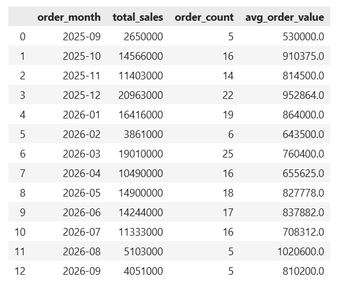
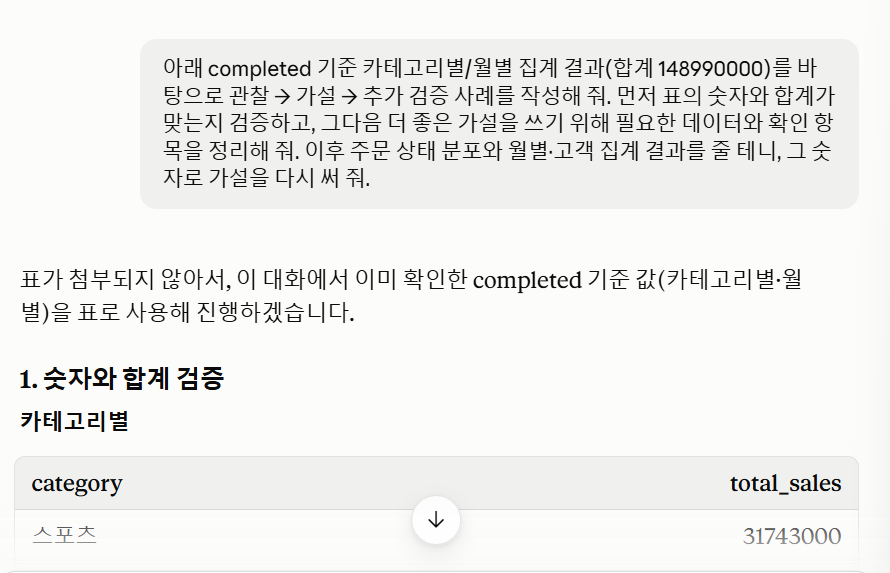

# Chapter 06 답안 양식. 데이터를 보며 질문을 만드는 EDA

> 이 내용을 `chapter06.ipynb`의 Markdown 셀로 작성합니다.

## 제출 정보
- 이름: 황지원
- GitHub ID: Jiwon0712
- 작성일: 2026-10-13
- 최종 Notebook URL: https://github.com/Jiwon0712/llm-data-analysis-study/blob/main//chapter06/chapter06.ipynb

## 1. 내가 정한 EDA 질문
| 질문 | 분석 범위 | 지표 | 검증 방법 |
| --- | --- | --- | --- |
| 월별 매출은 어떻게 변하는가? | 전체 기간, 월 단위 | 월별 총매출 | `groupby()`로 월별 합계 계산 후 선 그래프 확인 |
| 카테고리별 매출 비중은 어떻게 다른가? | 전체 카테고리 | 카테고리별 매출 비중(%) | `groupby()`로 카테고리별 총매출 계산 후 전체 대비 비율 산출 |
| 매출 비중이 가장 큰 카테고리의 단가는 다른 카테고리보다 높은가? | 상위 카테고리 vs 나머지 | 평균 단가, 판매 수량 | `groupby()`로 카테고리별 평균 단가와 수량 비교 |

### 왜 이 질문을 선택했는가?
질문 1: 분석의 출발점, 매출이 시간에 따라 증가/감소하는지, 특정 시기에 몰리는 패턴이 있는지 먼저 파악하고자 하였다. 
질문 2: 매출이 어떤 상품군에 집중되어 있는지 알아야 어디를 더 자세히 봐야 할지 판단할 수 있다. 그룹 간 차이를 확인하는 가장 기본적인 질문.
질문 3: 카테고리별 비교에서 나온 관찰을 가설로 이어가기 위하여 선택하였다. 특정 카테고리의 매출 비중이 높게 나올 것이라는 생각을 염두에 두고, 그 이유가 단가가 높아서일 수 있다는 가설을 세우기 위함.

## 2. 핵심 집계 결과
- completed 원본 합계: 148990000

- 카테고리별 합계: 
catogory total_sales 
스포츠 31743000
전자기기 26400000
생활용품 23915000
뷰티 23383000
식품 16573000
도서 16389000
패션 10587000
합계 148990000

- 월별 합계:
order_month	total_sales
2025-09	2650000
2025-10	14566000
2025-11	11403000
2025-12	20963000
2026-01	16416000
2026-02	3861000
2026-03	19010000
2026-04	10490000
2026-05	14900000
2026-06	14244000
2026-07	11333000
2026-08	5103000
2026-09	4051000
합계 148990000

- 총합 일치 여부: 카테고리별/월별 전체 합계 모두 148,990,000으로 completed 원본 합계와 일치.

### 결과 관찰
카테고리별 매출 합계는 스포츠, 전자기기, 생활용품, 뷰티, 식품, 도서, 패션 순으로 높다.
월별 매출 합계는 가장 높은 달은 2025-12, 가장 낮은 달은 2025-09이다. 
카테고리별/월별 매출의 전체 합계는 completed 원본 합계와 일치하므로 데이터에 누락은 없다. 

### 나의 해석과 판단
스포츠 한 카테고리가 전체의 약 21.3%를 차지하고, 상위 3개 카테고리를 합치면 약 54.7%다. 반면 패션은 약 7.1%로 가장 작아서 카테고리 간 편차가 크다.
월별로는 2025-12(20963000)와 2026-03(19010000)에서 매출이 높고, 2026-02(3861000)는 크게 낮다. 2025-09(2650000)와 2026-09(4051000)는 첫 달과 마지막 달이라 월 전체가 집계되지 않았을 가능성이 있어, 낮은 값을 실제 매출 부진으로 단정하기 어렵다.
이번 집계는 주문 상태가 completed인 건만 포함하므로 확정 매출 기준의 결과다.

### 업무·분석적 의미
- 매출 상위 카테고리인 스포츠와 전자기기는 재고 확보와 프로모션 우선순위를 정할 때 기준이 될 수 있다.
- 매출 비중이 낮은 패션, 도서는 판매 부진 원인을 따로 점검할 필요가 있다.
- 연말인 2025-12에 매출이 높았으므로 시즌성 수요에 대비한 재고/마케팅 계획을 검토할 수 있다.
- 필터 적용 전 전체 주문 합계(255610000)와 completed 합계(148990000)의 차이가 크므로, 매출 보고 시 기준을 명확히 구분해야 한다.

### 한계와 추가 확인 사항
- 이번 결과는 매출 금액만 본 것이므로 주문 건수, 수량, 평균 단가를 함께 봐야 매출 차이의 원인을 알 수 있다.
- 2025-09와 2026-09는 월 일부만 집계됐을 수 있어 기간의 시작일과 종료일 확인이 필요하다.
- completed가 아닌 주문이 전체 주문 금액의 약 41.7%에 달하므로, 상태별 비중과 원인을 추가로 확인해야 한다.
- 월별 추이는 13개월 데이터라 계절성이나 추세를 단정하기에는 기간이 짧다.

## 3. 관찰 → 가설 → 추가 검증
### 사례 1
- 관찰: completed 기준 카테고리 매출은 스포츠 31743000(21.3%)이 가장 크고 패션 10587000(7.1%)이 가장 작아 약 3.0배 차이가 난다. 수량 순위(스포츠 295, 생활용품 272, 전자기기 259, 뷰티 223, 도서 149, 식품 133, 패션 111)와 매출 순위는 대체로 비슷하지만 두 곳이 어긋난다. 생활용품은 수량 2위인데 매출은 3위이고(판매단가 약 87923으로 가장 낮음), 식품은 수량이 도서보다 적은데 매출은 더 높다(판매단가 약 124609 vs 109993). 상품 수는 스포츠 19개, 패션 11개, 식품 7개다.
- 가설: 카테고리 간 매출 차이는 주로 판매 수량에서 나오고, 단가는 순위를 일부 바꾸는 보조 요인이다. 패션과 도서는 상품당 판매 수량이 약 10개로 낮아 매출이 작고, 식품은 상품이 7개뿐이어도 상품당 19개가 팔리고 단가가 높아 매출 5위를 유지한다.
- 추가 검증: category_sales에 판매단가(total_sales ÷ total_quantity)와 상품당 판매 수량(total_quantity ÷ product_count)을 계산해 순위를 비교한다. 매출 차이를 수량 효과와 단가 효과로 나눠서 어느 쪽이 더 큰지 확인한다. 카테고리 상품 목록의 avg_price는 판매 가중이 아니므로 판매단가와 구분해서 해석한다.

### 사례 2
- 관찰: 2026-08은 전체 주문 20건 중 completed가 5건(25.0%)뿐이라 completed 매출이 5103000으로 낮다. 다른 달의 completed 주문 비율은 42.9%(2026-02)~73.3%(2025-12) 범위다. 2026-08 주문 건수 20건은 2026-07(23건)과 크게 다르지 않고, completed 5건의 평균 주문 금액은 1020600으로 13개월 중 가장 높다. 전체 기준으로 completed가 아닌 주문은 취소 64건, 환불 52건으로 116건(38.7%)이며, 이 주문들의 평균 금액은 약 919138로 completed(약 809728)보다 높다.
- 가설: 2026-08의 매출 하락은 수요 감소가 아니라 취소/환불이 그 달에 집중되어 생긴 결과다. 상태 값이 completed, cancelled, refunded 세 가지뿐이므로 처리 지연보다는 취소/환불 증가가 원인일 가능성이 크다. 취소/환불 주문의 평균 금액이 더 높은 것으로 보아 고액 주문일수록 취소/환불로 이어지는 경향도 있을 것이다.
- 추가 검증: 월 × order_status 피벗으로 2026-08의 cancelled와 refunded 건수를 확인한다. 같은 방식으로 14건 중 6건이 completed인 2026-02도 비교한다. 2026-08의 취소/환불 주문을 payment_method, category, customer_id로 나눠 한쪽에 몰려 있는지 본다. 월 주문 수가 5~38건으로 적어 변동이 클 수 있으므로 월별 completed 비율 평균과 함께 판단한다.

### 사례 3
- 관찰: 구매 금액 상위 10명(customer_id 102, 117, 83, 142, 40, 30, 3, 14, 146, 111)의 총매출은 4067000~5977000이다. 상위 10명 안에서도 유형이 갈린다. 5명(102, 117, 83, 40, 30)은 주문 5건 이상이고, 나머지 5명(142, 3, 14, 146, 111)은 주문이 3~4건인데 건당 평균이 1016750~1620667로 높다. customer_id 30(7건, 평균 693286)과 142(3건, 평균 1620667)는 총액이 4853000과 4862000으로 거의 같다. 도시는 서울과 성남이 각 3명이다.
- 가설: 고액 고객은 한 유형이 아니라 반복 구매형과 고단가형으로 나뉜다. 반복 구매가 고액의 주된 이유라면 상위 고객의 주문 횟수가 전체 고객 평균보다 뚜렷하게 높을 것이고, 고단가 구매가 이유라면 건당 금액이 전체 평균 주문 금액보다 높을 것이다. 상위 10명 중 9명이 후자 조건을 만족하므로 건당 금액의 영향이 더 커 보인다.
- 추가 검증: 고객별 주문 횟수 분포를 구해 상위 고객과 전체 고객의 평균 주문 횟수를 비교한다. 상위 10% 고객이 전체 매출에서 차지하는 누적 비중을 계산한다. 반복형과 고단가형을 나눠 선호 카테고리와 도시를 비교하고, 도시별 구매 금액 차이도 확인한다. 고객 집계표가 completed 기준인지 확인하고, 아니라면 필터 후 다시 계산한다.

## 4. LLM 질문 확장
- Safe Context: 원본 주문 행은 제공하지 않고 집계 결과표만 제공함(카테고리별 매출, 월별 매출, 주문 상태 분포, 결제수단 분포, 상위 고객 표). 컬럼 구조는 order_items, orders, products, customers 기준. 결과물에는 고객 이름을 쓰지 않고 customer_id만 사용함.

- Prompt: completed 기준 카테고리별/월별 집계 결과를 바탕으로 관찰 → 가설 → 추가 검증 사례를 작성하고 숫자가 맞는지 먼저 검증해 줘. 그다음 더 좋은 가설을 쓰기 위해 필요한 데이터와 확인 항목을 정리해 줘. 이후 상태 분포와 월별·고객 집계 결과를 줄 테니 그 숫자로 가설을 다시 써 줘.

- LLM 제안 요약: 가설 근거를 보강할 자료로 주문 상태 분포, 카테고리 × 상태 피벗, 월 × 상태 피벗, completed 기준 수량/판매단가, 날짜 범위, 이상치/집중도, 비교 지표(월별 completed 비율 등)를 제안함. 실제 데이터를 받은 뒤에는 사례 1(수량 vs 단가), 사례 2(2026-08 취소/환불 집중), 사례 3(고액 고객의 반복 구매형 vs 고단가형) 가설과 검증 방법을 제시함.

- 실제 사용 여부: 수정 후 사용

- 판단 이유: LLM의 첫 가설은 배송 중, 처리 중 주문이 많다는 가정을 포함했는데, 실제 주문 상태는 completed, cancelled, refunded 세 가지뿐이라 데이터와 맞지 않아 폐기하고 취소/환불 중심으로 바꿈. 상위 3개 카테고리 비중이 54.7%로 잘못 계산되어 있어 직접 다시 계산해 55.1%로 고침. 가설은 필터 전 대비 completed 비율 같은 숫자에 근거해 사실로 단정하지 않고 검증 필요 항목으로만 남김.

- 사람이 수정한 내용: 원본 코드는 고치지 않고 completed 필터만 추가하도록 요청해 sales_items와 order_sales에 필터를 적용함. 필터 적용 후 카테고리별·월별 합계가 148990000으로 completed 원본 합계와 일치하는지 확인함. 숫자에서 콤마를 제거하고 형식을 노트북에 맞춤. 필터 전 값(255610000)으로 쓰인 수량, 단가를 completed 기준으로 다시 계산하도록 고침.

## 5. 다음 분석 우선순위
1. 월 × order_status 피벗과 카테고리 × order_status 피벗 (cancelled, refunded가 특정 월, 카테고리에 몰려 있는지 확인)
2. completed 기준 카테고리별 판매단가(total_sales ÷ total_quantity)와 상품당 판매 수량 비교. 즉 매출 차이가 수량 때문인지 단가 때문인지 분해.
3. 고객별 주문 횟수 분포와 상위 고객 매출 누적 비중. 즉 고액 고객이 반복 구매형인지 고단가형인지 확인.

### 가장 먼저 확인하고 싶은 이유
completed 매출은 148990000으로, 전체 주문 금액 255610000의 약 58.3%뿐이다. 나머지 약 41.7%가 취소·환불이라 매출 해석이 어떤 상태가 어디에 몰렸는지에 크게 좌우된다. 주문 20건 중 completed 주문이 5건인 2026-08처럼 월별 매출이 급격히 낮은 구간도 수요 감소인지 취소/환불 집중인지 상태 피벗으로 먼저 구분해야 이후 카테고리, 고객 분석의 기준이 흔들리지 않는다.

### 현재 데이터만으로 단정할 수 없는 것
- 2026-08 등 특정 월의 낮은 completed 매출이 취소/환불 집중 때문인지는 상태별 월 분포 없이는 확정할 수 없다.
- 카테고리 간 매출 차이가 수량 때문인지 단가 때문인지, 현재는 순위 비교로 추정만 한 상태다.
- 고액 고객이 반복 구매형인지 고단가형인지, 고객 표가 completed 기준인지 확인되지 않았다.
- 2025-09, 2026-09는 주문이 각 5건뿐이라 부분 월인지 확정할 수 없다(order_date의 min, max 확인 필요).
- 13개월 데이터라 계절성이나 추세를 단정하기에는 기간이 짧다.
- 취소/환불의 원인은 데이터에 없어 알 수 없다.

## 최종 체크
- [x] 질문과 지표가 연결되어 있습니다.
- [x] 집계 총합을 검증했습니다.
- [x] 관찰과 가설을 구분했습니다.
- [x] 다음 검증 질문을 작성했습니다.
- [x] LLM 제안을 검증했습니다.
- [x] 최종 Notebook URL을 제출합니다.