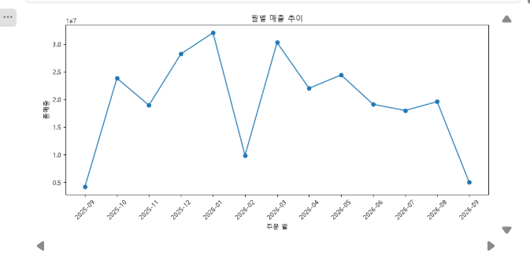
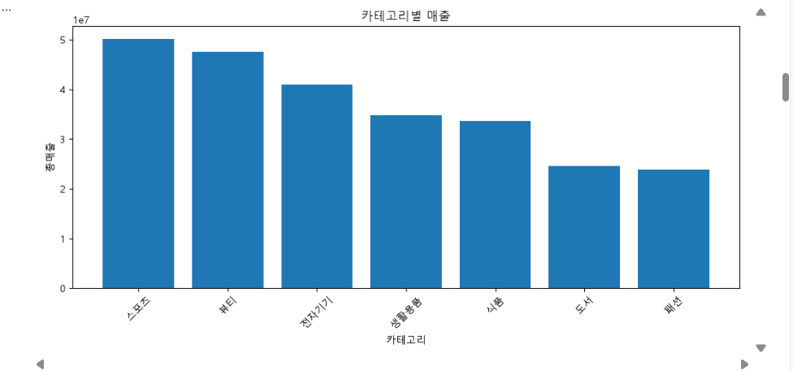
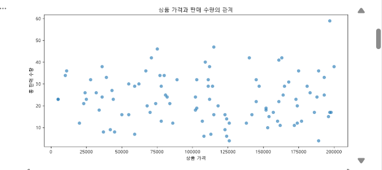

# Chapter 07 답안 양식. 그래프로 데이터의 이야기를 보여주기

> 이 내용을 `chapter07.ipynb`의 Markdown 셀로 작성합니다.

## 제출 정보
- 이름: 황지원 
- GitHub ID: Jiwon0712
- 작성일:2026-10-22
- 최종 Notebook URL: https://github.com/Jiwon0712/llm-data-analysis-study/blob/main//chapter07/chapter07.ipynb

## 1. 시각화 질문과 그래프 선택
| 질문 | 선택한 그래프 | 선택 이유 |
| --- | --- | --- |
| 월별 매출은 어떻게 변하는가? | 선 그래프 | 시간 순서에 따른 추세를 보기 좋음 |
| 카테고리별 매출 비중은 어떻게 다른가? | 막대 그래프 | 카테고리 간 크기 비교가 쉬움 |
| 상품 가격이 높을수록 판매 수량이 줄어드는가? | 산점도 | 두 숫자형 변수의 관계와 분포를 점으로 한눈에 확인할 수 있고, 상품 하나하나의 위치를 볼 수 있기 때문 |

## 2. 대표 그래프 1

### 원본 집계값
| order_month | total_sales | order_count |
| --- | --- | --- |
| 2025-09 | 4194000 | 8 |
| 2025-10 | 23833000 | 25 |
| 2025-11 | 18954000 | 23 |
| 2025-12 | 28238000 | 30 |
| 2026-01 | 32055000 | 33 |
| 2026-02 | 9879000 | 14 |
| 2026-03 | 30286000 | 38 |
| 2026-04 | 22010000 | 26 |
| 2026-05 | 24424000 | 28 |
| 2026-06 | 19124000 | 24 |
| 2026-07 | 18000000 | 23 |
| 2026-08 | 19598000 | 20 |
| 2026-09 | 5015000 | 8 |

### 결과 관찰
- 분석 기간은 2025년 9월부터 2026년 9월까지 13개월이며, 총매출은 약 2억 5561만 원, 총 주문은 300건이다.
- 월 매출이 가장 높은 달은 2026년 1월로 32055000원이고 주문은 33건입니다. 주문 건수가 가장 많은 달은 2026년 3월로 38건이고 매출은 30286000원이다.
- 시작월인 2025년 9월과 마지막 달인 2026년 9월을 제외한 11개월을 보면, 월평균 매출은 약 2240만 원이고 월평균 주문은 약 25.8건이다.
- 가장 낮은 달은 2026년 2월로 매출 9879000원, 주문 14건이다. 앞달인 2026년 1월은 32055000원, 뒷달인 2026년 3월은 30286000원이므로 크게 줄었다가 바로 회복했다.
- 2025년 9월은 매출 4194000원, 2026년 9월은 매출 5015000원이며, 두 달 모두 주문이 8건으로 매우 적다.
- 2025년 10월부터 2026년 3월까지 월평균 매출은 약 2387만 원이고, 2026년 4월부터 8월까지는 약 2063만 원이어서 후반부가 약 14% 낮다.

### 나의 해석과 판단
- 매출은 뚜렷한 장기 성장이나 하락 없이 월 1800만 원에서 3200만 원 사이를 오르내리는 양상.
- 2026년 2월의 급감은 일시적 하락으로 보임. 2월은 일수가 짧아 영향을 주었을 가능성이 있지만, 이 데이터만으로 원인을 확정할 수는 없을 듯.
- 2025년 9월과 2026년 9월의 낮은 값은 실제 매출 부진이 아니라 데이터가 해당 월의 일부만 포함한 결과일 가능성이 높다고 판단. 따라서 추세를 해석할 때는 이 두 달을 제외하거나 부분 월로 구분하는 것이 적절하다.
- 월 매출과 주문 건수가 대체로 같은 방향으로 움직이므로 매출 변동은 주로 주문 건수 변화에서 비롯된 것으로 보임. 건당 평균 매출은 월별로 약 70만 원에서 98만 원 사이이고 전체 평균은 약 85만 원이어서 상대적으로 안정적.

### 업무·분석적 의미
- 2025년 12월, 2026년 1월, 2026년 3월에 매출이 높았으므로 이 시기에 맞춘 프로모션과 재고 준비를 검토할 수 있다.
- 2026년 4월 이후 매출이 소폭 낮아진 흐름이 이어지는지 모니터링하고, 필요하면 고객 수, 주문 건수, 상품 구성으로 나누어 원인을 확인할 필요가 있다.
- 매출 관리 지표로는 총매출뿐 아니라 주문 건수와 건당 평균 매출을 함께 보는 것이 변동 원인을 파악하는 데 유용하다.

### 한계와 추가 확인 사항
- 데이터 기간이 13개월뿐이라 같은 달을 연도별로 비교할 수 없으므로 2월 특이적 감소 같은 계절성을 확정하기 어렵다.
- 시작월과 마지막 달이 부분 월인지는 order_date의 최솟값과 최댓값으로 확인해야 한다.
- 취소나 환불 주문이 total_sales에 포함되었는지 order_status 기준으로 확인 필요.
- 월 단위 집계라 일별, 주별 변동이나 특정 고객, 상품의 영향은 드러나지 않는다. 카테고리별, 고객별 분석으로 원인을 추가로 확인해야 한다.

## 3. 대표 그래프 2

### 원본 집계값
| category | total_quantity | total_sales | sales_ratio |
| --- | --- | --- | --- |
| 스포츠 | 468 | 50174000 | 19.63 |
| 뷰티 | 376 | 47551000 | 18.60 |
| 전자기기 | 401 | 41003000 | 16.04 |
| 생활용품 | 390 | 34839000 | 13.63 |
| 식품 | 240 | 33597000 | 13.14 |
| 도서 | 238 | 24645000 | 9.64 |
| 패션 | 220 | 23801000 | 9.31 |

### 결과 관찰
- 7개 카테고리의 총매출은 255610000원이고 총 판매 수량은 2333개이다.
- 매출 1위는 스포츠로 50174000원이며 비중은 19.63%이다. 2위는 뷰티로 47551000원이고 비중은 18.60%이다.
- 가장 낮은 카테고리는 패션으로 23801000원이며 비중은 9.31%이다. 1위인 스포츠는 패션의 약 2.1배이다.
- 상위 2개 카테고리인 스포츠와 뷰티의 비중 합계는 38.23%이고, 상위 3개 카테고리까지 더하면 54.27%이다.
- 판매 수량도 스포츠가 468개로 가장 많고 패션이 220개로 가장 적다.
- 뷰티는 수량이 376개로 4위이지만 매출은 2위이다. 식품은 수량이 240개로 5위이고 매출도 33597000원으로 5위여서 순위 차이는 없다.

### 나의 해석과 판단
- 한 카테고리가 매출을 독점하는 구조는 아니다. 1위 비중이 19.63%에 그치고 7개 카테고리가 9%에서 20% 사이에 분포한다.
- 스포츠는 수량과 매출이 모두 1위여서 판매량이 매출 1위를 이끈 것으로 보인다. 반면 뷰티는 수량 4위인데 매출 2위여서, 매출 순위를 만드는 요인이 카테고리마다 다를 가능성이 있다. 이 원인은 다음 단계에서 확인한다.
- 도서와 패션은 수량과 매출이 모두 하위권이어서 전체 매출 기여가 상대적으로 작다.
- 카테고리 간 순위 차이가 어느 정도 통계적으로 의미 있는지는 이 표만으로 판단할 수 없다. 따라서 순위가 가까운 카테고리 사이는 우열을 단정하지 않는 것이 좋다.

### 업무·분석적 의미
- 스포츠와 뷰티가 매출의 약 38%를 차지하므로 재고 확보와 프로모션 우선순위를 정할 때 핵심 카테고리로 볼 수 있다.
- 스포츠는 판매 수량이 가장 많은 카테고리이므로 재고 부족과 배송 지연 관리가 매출에 직접 영향을 줄 수 있다.
- 도서와 패션은 매출 비중이 낮아 개선 여지가 있는지, 아니면 현 수준을 유지할지를 목표 기준에 맞춰 판단할 필요가 있다.

### 한계와 추가 확인 사항
- 13개월 전체를 합산한 값이라 카테고리별 월별 변화와 계절성은 드러나지 않는다. 월별 카테고리 매출을 추가로 확인해야 한다.
- 뷰티처럼 수량 순위와 매출 순위가 어긋나는 카테고리의 원인은 이 표만으로 알 수 없으므로 다음 단계에서 단가 분석으로 확인해야 한다.
- 취소나 환불 주문이 포함되었는지 order_status 기준으로 확인이 필요하다.
- 카테고리 안에서 소수의 상품이나 고객이 매출을 대부분 만드는지는 이 표로 알 수 없으므로 상품별, 고객별 분석이 추가로 필요하다.
- 부분 월로 보이는 2025년 9월과 2026년 9월이 합계에 포함되어 있어, 이를 제외하면 비중이 조금 달라질 수 있다.

## 4. 대표 그래프 3

### 원본 집계값
산점도에는 상품 단위 데이터가 사용되었다. 점 개수는 상품 수와 같은 100개이며, 전체 값은 표로 싣지 않고 아래에 요약 통계와 대표 상품만 제시하였다.

요약 통계

| 항목 | price | total_quantity |
| --- | --- | --- |
| count | 100.0 | 100.0 |
| mean | 110040.0 | 23.3 |
| std | 56433.9 | 10.9 |
| min | 5000.0 | 4.0 |
| 25% | 65750.0 | 15.8 |
| 50% | 112000.0 | 23.0 |
| 75% | 161000.0 | 31.2 |
| max | 200000.0 | 59.0 |

상관계수

| 항목 | price | total_quantity |
| --- | --- | --- |
| price | 1.000 | -0.018 |
| total_quantity | -0.018 | 1.000 |

판매 수량 상위 5개 상품

| product_name | category | price | total_quantity |
| --- | --- | --- | --- |
| 식품 상품 058 | 식품 | 197000 | 59 |
| 패션 상품 011 | 패션 | 115000 | 47 |
| 생활용품 상품 082 | 생활용품 | 75000 | 46 |
| 스포츠 상품 041 | 스포츠 | 163000 | 42 |
| 전자기기 상품 077 | 전자기기 | 71000 | 42 |

판매 수량 하위 5개 상품

| product_name | category | price | total_quantity |
| --- | --- | --- | --- |
| 스포츠 상품 008 | 스포츠 | 189000 | 4 |
| 스포츠 상품 076 | 스포츠 | 126000 | 4 |
| 패션 상품 019 | 패션 | 108000 | 6 |
| 도서 상품 094 | 도서 | 124000 | 6 |
| 스포츠 상품 035 | 스포츠 | 59000 | 7 |

### 결과 관찰
- 산점도에 사용된 상품은 100개이다. 상품 가격은 5000원에서 200000원까지, 총 판매 수량은 4개에서 59개까지 분포한다.
- 가격의 평균은 110040원이고 중앙값은 112000원이다. 판매 수량의 평균은 23.3개이고 중앙값은 23.0개이다.
- 가격과 판매 수량의 상관계수는 -0.018로 0에 가깝다. 산점도에서도 점이 전체 구간에 넓게 흩어져 있고 뚜렷한 우하향 패턴은 보이지 않는다.
- 판매 수량 상위 5개 상품의 가격은 71000원에서 197000원까지 퍼져 있다. 1위인 식품 상품 058은 197000원으로 59개가 팔렸고, 3위인 생활용품 상품 082는 75000원으로 46개가 팔렸다.
- 판매 수량 하위 5개 상품 중 3개가 스포츠이다. 스포츠 상품 008은 189000원인데 4개만 팔렸고, 스포츠 상품 035는 59000원인데 7개가 팔렸다.

### 나의 해석과 판단
- 가격이 높을수록 판매 수량이 줄어드는 경향은 이 데이터에서 확인되지 않는다. 상관계수가 0에 가깝고 점의 분포에도 방향성이 없기 때문이다.
- 가격이 높아도 많이 팔린 상품과 가격이 낮아도 적게 팔린 상품이 모두 있으므로, 가격만으로 판매 수량을 설명하기는 어렵다.
- 다만 상관계수는 선형 관계만 측정하므로, 가격과 판매 수량이 무관하다고 단정하지는 않는다. 특정 가격 구간에서만 나타나는 관계는 상관계수로 잡히지 않을 수 있다.
- 산점도만으로 원인 관계를 판단할 수 없으며, 판매 수량에는 카테고리나 상품 특성 같은 다른 요인이 작용했을 가능성이 있다.

### 업무·분석적 의미
- 가격 인상이나 인하가 판매 수량을 바로 바꿀 것이라고 전제하기 어려우므로, 가격 정책을 정할 때 가격 하나만 근거로 삼지 않는 것이 적절하다.
- 판매 수량 상위 상품과 하위 상품의 특성을 카테고리나 상품 구성 기준으로 비교하면 판매량 차이를 만드는 요인을 찾는 데 도움이 된다.
- 하위 5개 중 스포츠 상품이 3개 포함되어 있으므로, 스포츠 카테고리 안에서 판매량이 낮은 상품의 공통점을 확인할 가치가 있다.

### 한계와 추가 확인 사항
- 상품별 판매 기간과 노출 정도가 다를 수 있으나 이 그래프에는 반영되지 않았다.
- 카테고리별로 가격과 판매 수량의 관계가 다른지는 이 그래프만으로 알 수 없으므로, 카테고리별로 나누어 확인해야 한다.
- 상관계수는 선형 관계만 보여 주므로, 가격 구간을 나누어 구간별 평균 판매 수량을 비교하는 방법으로 보완할 수 있다.
- 취소나 환불 주문이 판매 수량에 포함되었는지 order_status 기준으로 확인이 필요하다.
- 하위 5개 중 스포츠가 3개라는 점은 상품 수가 100개인 데이터에서 나온 관찰이므로, 카테고리별 상품 수를 함께 봐야 의미를 판단할 수 있다.

## 5. 그래프 정확성 점검
- [x] 그래프 값과 집계표 값 일치
- [x] 축 이름 확인
- [x] 단위 확인 (데이터에 단위 표기가 없음.)
- [x] 범례 확인 
- [x] 날짜 정렬 확인 
- [x] 과장될 수 있는 축 범위 확인
- [x] 제목이 분석 범위를 정확히 표현

### 내가 발견한 시각화 위험 또는 개선점
- 월별 매출 선 그래프의 세로축이 0이 아니라 약 0.3e7 근처에서 시작한다. 선 그래프에서는 허용되지만 2026년 2월의 급감과 양 끝 두 달의 하락이 실제보다 크게 보일 수 있어 해석에 주의해야 한다.
- 2025년 9월과 2026년 9월은 주문이 각각 8건뿐인데 그래프에는 다른 달과 같은 방식으로 표시된다. 데이터가 해당 월의 일부만 포함했을 가능성이 있으나 그래프에는 드러나지 않아, 실제 매출 부진으로 오해할 위험이 있다. 부분 월을 다른 표식이나 색으로 구분하거나 설명을 덧붙이는 것이 좋을 것 같다.
- 카테고리 막대 그래프와 월별 선 그래프의 세로축이 1e7 지수 표기로 되어 있어 눈금을 읽기 불편하다. 백만 원 단위로 바꾸면 읽기 쉬워질 듯하다.
- 세 그래프 모두 축 이름에 단위가 없다. 데이터 파일에 단위가 명시되어 있지 않으므로, 따로 확인이 필요하다.
- 카테고리 막대 그래프에서 식품과 도서처럼 순위가 가까운 막대는 차이가 작은데 막대만 보면 순위가 뚜렷하게 갈리는 것처럼 보일 수 있다. 막대 위에 값이나 비중을 표시하면 차이의 크기를 함께 전달할 수 있다.
- 산점도에서는 가격 5000원 근처에 점이 겹쳐 보여 점 개수를 정확히 세기 어렵다. 투명도를 조절하거나 점 크기를 줄이면 겹침을 구분할 수 있다.
- 산점도는 카테고리 구분 없이 전체 상품을 한 색으로 표시한다. 카테고리별로 색을 나누면 가격과 판매 수량의 관계가 카테고리마다 다른지 확인할 수 있다.
- 산점도에 추세선이나 상관계수가 없어 관계의 방향과 강도를 눈으로만 판단하게 된다. 상관계수 -0.018을 그래프 설명에 함께 제시하면 해석의 근거가 분명해진다.

## 6. Chapter 07 최종 판단

### 가장 중요한 그래프 1개와 이유
- 가장 중요한 그래프는 월별 매출 추이 선 그래프이다.
- 13개월 동안의 매출 변화를 한눈에 보여 주며, 2026년 1월의 최고점과 2026년 2월의 급감 같은 변동 구간을 바로 확인할 수 있다.
- 양 끝 두 달이 유독 낮게 나타나 데이터 범위와 품질을 점검해야 한다는 힌트를 주고 있으므로, 추가 분석의 출발점이 된다.
- 카테고리 막대 그래프와 산점도는 매출을 구성하는 요인을 보여 주지만, 시간에 따라 무엇이 바뀌었는지는 월별 그래프가 가장 잘 보여 준다.

### 그래프가 보여 준 사실
- 월별 매출은 2025년 9월부터 2026년 9월까지 13개월 동안 뚜렷한 장기 상승이나 하락 없이 오르내렸다. 최고 매출은 2026년 1월 32055000원이다.
- 2025년 9월 4194000원과 2026년 9월 5015000원을 제외한 11개월 중에서는 2026년 2월 9879000원이 가장 낮다.
- 카테고리별로는 스포츠가 50174000원으로 1위이고 뷰티가 47551000원으로 2위이다. 상위 2개가 전체 매출의 38.23%를 차지하고, 1위는 7위 패션의 약 2.1배이다.
- 카테고리 평균 단가는 식품이 가장 높고 뷰티가 두 번째이다. 매출 상위 3개 카테고리의 가중 평균 단가는 나머지 4개보다 약 4000원 높은 정도여서 차이가 작다.
- 상품 가격과 판매 수량의 상관계수는 -0.018로 0에 가깝고, 산점도에서도 가격이 높을수록 판매 수량이 줄어드는 패턴은 보이지 않는다.

### 그래프만으로 말할 수 없는 것
- 2026년 2월 급감의 원인은 알 수 없다. 2월이 짧다는 점이나 계절성은 가능성일 뿐이다. 데이터에서 두 번 나오는 달은 9월뿐이고 그마저 두 번 모두 월 전체가 아니라 부분일 가능성이 있어, 같은 달을 연도별로 비교해 계절성을 확인하기 어렵다.
- 2025년 9월과 2026년 9월이 부분 월인지는 그래프만으로 확정할 수 없고 order_date의 최솟값과 최댓값으로 확인해야 한다.
- 가격이 판매 수량에 영향을 주지 않는다고 단정할 수 없다. 상관계수는 선형 관계만 측정하고, 산점도는 원인 관계를 보여 주지 못한다.
- 스포츠의 매출 1위가 높은 판매 수량 때문인지, 뷰티의 2위가 높은 단가 때문인지는 상품 단위와 월별 단위로 나누어 보기 전에는 확정할 수 없다.
- 금액 단위는 데이터에 명시되어 있지 않다. 취소나 환불 주문이 포함되었는지도 확인되지 않았다.

### 다음 분석에서 확인할 질문
- 2025년 9월과 2026년 9월의 주문 날짜 범위는 어떻게 되며, 두 달을 제외하면 월별 추세가 어떻게 달라지는가?
- 2026년 2월의 매출 감소는 주문 건수 감소 때문인가, 건당 매출 감소 때문인가?
- 카테고리별 월별 매출은 어떻게 변하며, 스포츠와 뷰티의 상위 순위는 모든 달에서 유지되는가?
- 수량 순위보다 매출 순위가 높은 뷰티는 고단가 상품이 매출을 이끈 것인가?
- 카테고리별로 나누어 보면 가격과 판매 수량의 관계가 달라지는가?
- 취소나 환불 주문을 제외하면 월별 매출과 카테고리 비중이 어떻게 달라지는가?

## 최종 체크
- [x] 그래프와 수치를 교차 검증했습니다.
- [x] 관찰과 해석을 구분했습니다.
- [x] 업무적 의미와 한계를 작성했습니다.
- [x] 최종 Notebook URL을 제출합니다.