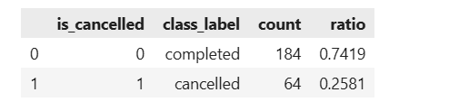
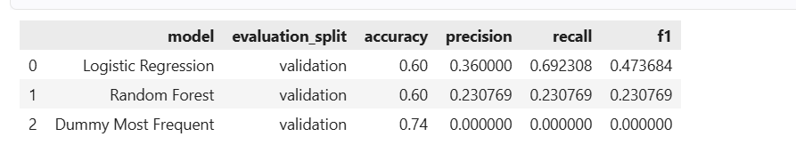
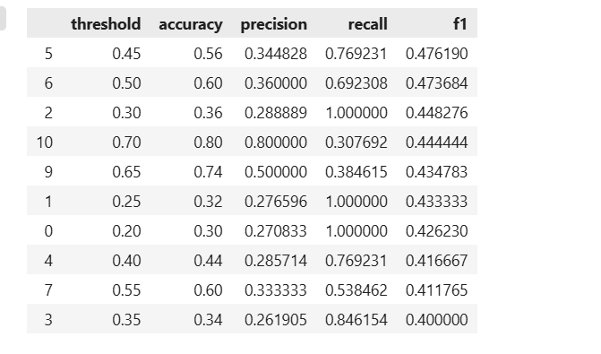
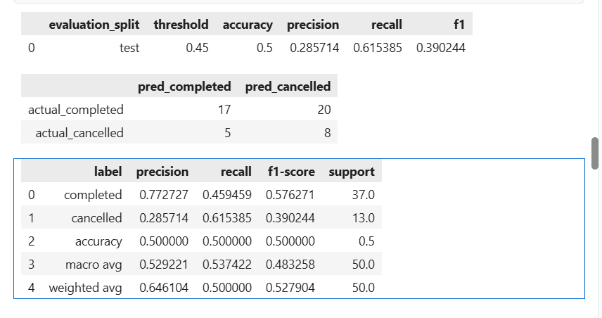

# Chapter 10 답안 양식. 분류 분석으로 주문 취소 여부 예측하기

> 이 내용을 `chapter10.ipynb`의 Markdown 셀로 작성합니다. 실제 실행 결과를 근거로 작성하고, 예측 패턴을 원인처럼 단정하지 않습니다.

## 제출 정보
- 이름: 황지원 
- GitHub ID: Jiwon0712
- 작성일: 2026.11.14
- 최종 Notebook URL: https://github.com/Jiwon0712/llm-data-analysis-study/blob/main//chapter10/chapter10.ipynb

## 1. 분류 문제 정의
- 타깃: completed, cancelled 주문 
- 0의 의미: completed 주문
- 1의 의미: cancelled 주문
- 제외한 상태: refunded와 기타 상태
- 예측 단위: 주문 1건 = 1행
- 예측 시점: 주문이 접수된 직후, 주문 취소 여부가 확정되기 전
- 예측 시점에 사용할 수 있는 정보: 고객 정보: age, gender, city, days_since_signup, 주문 정보: item_count, total_quantity, order_amount, payment_method, 시간 정보: order_month, order_dayofweek 
- 예측 이후에만 알 수 있어 제외한 정보: order_status, refunded 주문 52건

### 나의 해석과 판단
왜 이 타깃 범위와 예측 시점을 사용했는지 작성하세요.
- completed(0) vs cancelled(1)의 이진 분류를 선택하였다. 이 분석의 목적은 접수된 주문이 취소될 가능성을 예측하는 것이다. 취소는 주문 접수 후 처리 단계에서 발생하므로, 주문 단위로 정의되는 이진 타깃을 사용하는 것이 자연스럽다. 
- 예측 시점은 주문 접수 직후, 취소 여부 확정 전으로 설정하였다. 취소 가능성을 미리 알아야 개입이 의미가 있으므로 취소 여부가 확정되기 전을 기준으로 잡았다.
---

## 2. Feature Contract와 Leakage Audit

### 사용한 숫자형 Feature
숫자형 feature: ['age', 'item_count', 'total_quantity', 'order_amount', 'order_month', 'order_dayofweek', 'days_since_signup']

### 사용한 범주형 Feature
범주형 feature: ['gender', 'city', 'payment_method']

### 금지 Feature
```text
order_status
is_cancelled
order_id
customer_id
product_id
취소 이후 정보
```

### 나의 해석과 판단
파일에 컬럼이 존재하는 것과 예측 시점에 사용할 수 있는 것이 왜 다른지 작성하세요.
- 파일에 컬럼이 있다는 것은 데이터가 기록된 적이 있다는 뜻일 뿐이고, 그 값이 예측 시점에 알 수 있던 정보라는 것은 아니다. 이 분석의 예측 시점은 주문 접수 직후이므로 그 시점에 확정되어 있던 정보만 feature로 사용 가능하다. 같은 데이터 테이블 내에 있어도 컬럼별로 기록된 시점이 다르기 때문이다.
---

## 3. 주문 단위 특징과 병합 검증

### 계산 관계 확인

```text
line_total = quantity × unit_price
```

- 계산 불일치 건수: 0
- 주문 특징 `order_id` 중복 건수: 0

### 병합 검증

| 병합 | 관계 | 병합 전 행 수 | 병합 후 행 수 | 미매칭 | 판정 |
| --- | --- | ---: | ---: | ---: | --- |
| 주문 ↔ 주문 특징 | one_to_one | 248 | 248 | 0 | 통과 |
| 주문 ↔ 고객 | many_to_one | 248 | 248 | 0 | 통과 |

### 결과 관찰
- 두 병합 모두 병합 전후 행 수가 248행으로 같고, 미매칭도 0건이다. 별도 점검표의 `missing_order_item_features`와 `missing_customer_match`도 모두 0으로 서로 일치한다.
- 병합 대상 248건은 원본 orders 300건에서 refunded 52건을 제외한 수와 같다.
- 주문 ↔ 주문 특징은 one_to_one인데 병합 후 행 수가 늘지 않았으므로, 주문 특징에 `order_id` 중복이 없다고 판단했다. 주문 ↔ 고객은 many_to_one인데 행 수가 늘지 않았으므로 customers의 `customer_id`도 고유하다고 볼 수 있다.

### 나의 해석과 판단
미매칭을 원인 확인 없이 0으로 채우면 안 되는 이유를 작성하세요.
- 미매칭은 값이 0이라는 뜻이 아니라, 값을 알 수 없거나 데이터 연결에 실패했다는 뜻이다. 만약 원인을 확인하지 않고 0으로 채우면 다음과 같은 문제가 발생한다. 첫째로, 의미가 바뀐다. 예를 들어 고객 정보가 매칭되지 않았는데 'age = 0' 처럼 채워버리면 존재할 수 없는 값이 데이터에 포함된다. 둘째로, 파이프라인 오류가 숨겨진다. 미매칭이 키의 형식 불일치, 공백, 필터링 실수 같은 문제의 신호일 수 있는데 0으로 덮으면 같은 오류가 반복되어도 발견하기 어려워진다. 
---

## 4. 클래스 비율

| 클래스 | 의미 | 개수 | 비율 |
| ---: | --- | ---: | ---: |
| 0 | completed | 184 | 0.7419 |
| 1 | cancelled | 64 | 0.2581 |



### 결과 관찰
- 전체 248건 중 completed가 184건(74.19%), cancelled가 64건(25.81%)이다. 비율은 2.9:1이고, cancelled가 소수 클래스로 불균형이 뚜렷하게 존재한다.
- train, validation, test로 분할한 결과에서 각 split의 cancelled 비율이 25.68%, 26.00%, 26.00%로 전체의 cancelled 비율과 거의 같아, 층화 분할로 비율이 유지된다. 소수 클래스(cancelled)의 절대적인 건수가 적은데, validation과 test에는 각각 13건뿐이라 지표가 흔들릴 위험이 있다.

### 나의 해석과 판단
클래스 불균형이 accuracy 해석에 어떤 영향을 주는지 작성하세요.
- 이 데이터에서 모델이 어떤 것도 학습하지 않은 상태에서 모도느 주문을 completed로 예측해도 accuracy가 74.19%가 나온다. 따라서 accuracy 74.19%는 기준선이 된다. 예를 들어 accuracy가 80%여도 기준선보다 약 6%p 높을 뿐이고, 이것이 취소 주문을 실제로 잡아내서 도출된 건지는 알 수 없다. 
- 따라서, accuracy는 다수 클래스의 정답이 대부분을 차지하므로, 취소 주문을 못 잡아내어도 높게 나올 수 있다. 이 분석의 목적이 취소될 주문을 미리 예측하는 것임을 고려하면, 정작 중요하게 봐야 할 소수 클래스가 accuracy에 가려질 수 있다.  
- 따라서, 74.19%이라는 baseline을 기준으로 잡고 모델이 이 기준을 얼마나 넘는지를 봐야 한다. accuracy와 더불어 cancelled 클래스의 recall, precision, F1, PR-AUC를 함께 확인하고, confusion matrix로 취소 주문을 몇 건 놓쳤는지 확인한다. 취소 주문이 13건 규모인 test에서는 한두 건의 차이로 recall이 크게 달라지므로, 교차검증으로 안정성을 함께 확인한다.
---

## 5. Dummy Baseline과 Validation 모델 비교

| 모델 | Accuracy | Precision | Recall | F1 |
| --- | ---: | ---: | ---: | ---: |
| Dummy Most Frequent | 0.74 | 0.000000 | 0.000000 | 0.000000 |
| Logistic Regression | 0.60 | 0.360000 | 0.692308 | 0.473684 |
| Random Forest | 0.60 | 0.230769 | 0.230769 | 0.230769 |



- Validation에서 선택한 모델: Logistic Regression

### 결과 관찰
- validation 기준으로 Dummy Most Frequent는 Accuracy 0.74로 가장 높지만, 모든 주문을 completed로 예측하기 때문에 Precision, Recall, F1이 모두 0이다.
- Logistic Regression은 Accuracy 0.60으로 Dummy보다 낮지만, Precision 0.36, Recall 0.69, F1 0.47을 기록했다.
- validation의 취소 주문은 13건이므로 Logistic Regression의 Recall 0.692는 약 9건을 탐지했다는 뜻이다. Dummy는 0건, Random Forest는 13건 중 3건을 탐지했다.
- Random Forest와 비교해도 세 지표 모두 Logistic Regression이 높았다.

### 나의 해석과 판단
선택한 모델이 Dummy baseline보다 어떤 점에서 나아졌는지 작성하세요.
- 선택한 Logistic Regression은 Accuracy만 보면 Dummy baseline보다 낮지만, 이 프로젝트의 목적이 취소될 주문을 예측하는 것임을 고려하면 baseline이 전혀 하지 못한 일을 한다. Dummy는 Recall이 0건으로 취소를 단 한 건도 찾지 못해 예측 모델로서 쓸모가 없고, Accuracy 0.74는 completed가 74%라는 클래스 비율을 그대로 반영한 값일 뿐이다. 반면 Logistic Regression은 취소 13건 중 약 9건을 탐지했고, 취소라고 예측한 주문의 36%가 실제 취소였다. 이는 전체 취소 비율인 약 26%보다 높아서, 무작위로 고르는 것보다 취소 가능성이 높은 주문을 골라내는 능력이 있음을 보여준다.
- Accuracy가 낮아진 것은 취소를 더 많이 잡아내기 위해 completed 주문 일부를 취소로 잘못 예측했기 때문이다. 즉 취소 탐지(Recall)를 얻는 대신 오탐 증가(Accuracy와 Precision 하락)를 감수한 것이며, 취소를 놓치는 비용이 불필요한 확인 비용보다 크다면 이 교환은 타당하다.

### 한계와 추가 확인 사항
- validation의 취소가 13건뿐이라 지표가 크게 흔들릴 수 있고, Precision 0.36은 예측된 취소 10건 중 6건이 오탐이라는 뜻이다. 따라서 이 결과는  Dummy baseline보다 취소 탐지 능력이 있다는 근거로는 쓸 수 있지만, 성능이 충분하다는 결론은 test 평가와 교차검증으로 추가 확인한 뒤에 내려야 한다. 즉  baseline보다 Accuracy가 낮기 때문에 분석 목적이 취소 탐지라는 전제가 맞을 때만 타당한 선택이 된다. 
- Precision/Recall 외 지표를 확인하지 않았다. 현재 표에는 threshold 0.5 기준 지표만 있다. PR-AUC나 ROC-AUC처럼 threshold에 의존하지 않는 지표와 confusion matrix를 함께 보고 비교해야 한다.
---

## 6. Train / Validation / Test 역할

| Split | 역할 | 클래스 0 건수 | 클래스 1 건수 |
| --- | --- | ---: | ---: |
| Train | 모델 학습 | 110 | 38 |
| Validation | 모델/Threshold 선택 | 37 | 13 |
| Test | 선택 이후 최종 평가 | 37 | 13 |

### 나의 해석과 판단
- Test를 모델이나 Threshold 선택에 사용하면, 이미 그 데이터는 한 번 이상 학습한 데이터가 되어버린다. 여러 모델이나 여러 Threshold를 test 점수로 비교해 가장 좋은 것을 고르면 선택 과정에서 test의 우연한 특성을 이미 다 반영하여 고르게 되어 최종 점수가 실제 성능보다 좋게 나온다. 특히 이 분석처럼 test의 cancelled 건수가 13건뿐인 경우, 한두 건 차이로 지표가 크게 달라지므로 그 우연에 맞춘 선택의 영향이 더 크다. 그래서 test는 모델과 threshold 선택이 모두 확정된 뒤 최종 모델을 평가할 때 1번만 사용한다. 

### 교육용 random split의 한계
- 이번 분할은 클래스 비율을 유지한 무작위 분할이다. 학습 목적으로는 적절하지만, 실제 미래 주문을 예측하는 운영에 쓰기 전에는 다음 평가를 추가해야 한다.
- 시간 기준 분할 평가(out-of-time): 과거 주문 데이터로 학습하고, 이후 기간의 주문 데이터를 사용해 평가한다. 무작위 분할 방식은 미래 주문이 학습에 섞여 들어가 모델의 성능이 실제보다 좋게 나올 수 있기 때문이다.
- 고객 단위 분할 평가(group split): 고객은 150명, 주문 건 수는 248건이므로 같은 고객의 주문이 train과 test에 함께 들어갔을 수 있다. 고객 단위로 나눠 평가하여 처음 보는 고객에 대한 성능도 확인해야 한다.
- 교차검증, 신뢰구간: validation과 test의 cancelled 건수가 각각 13건뿐이라 분할을 1번만 하면 모델 점수가 불안정하다. 반복 교차검증 등으로 지표의 변동 범위를 확인해야 한다.
---

## 7. Validation 성능과 우선 지표
선택 모델: Logistic Regression, 선택 Threshold: 0.45
- Accuracy: 0.56
- Precision: 0.3448
- Recall: 0.7692
- F1: 0.4762

### 내가 가장 중요하게 본 지표
Recall을 가장 중요하게 보았고, Precision이 지나치게 무너지지 않는지 확인하는 보조 지표로 F1을 함께 보았다. 

### 그 이유
이 분석의 목적은 취소될 주문을 예측하는 것이므로, 취소를 놓치는 것(FN)이 불필요한 확인을 하는 것(FP)보다 손실이 크다고 가정했다. 다만 실제 FP/FN 비용 정보는 없으므로 이 판단은 가정이다. 취소 주문 확인 연락이 비싸거나 고객 불편이 큰 상황이라면 Precision 비중을 높여야 한다.
---

## 8. Threshold 비교

| Threshold | Precision | Recall | F1 | 예상 특징 |
| ---: | ---: | ---: | ---: | --- |
| 0.30 | 0.2889 | 1.0000 | 0.4483 | 취소 13건을 모두 탐지하지만 오탐이 매우 많다 (Accuracy 0.36). 거의 전부 취소로 예측하는 수준 |
| 0.45 | 0.3448 | 0.7692 | 0.4762 | F1 최고. 취소 13건 중 10건을 탐지하고, 오탐은 19건 |
| 0.50 | 0.3600 | 0.6923 | 0.4737 | 기본값. 0.45와 F1이 거의 같지만 취소 탐지가 1건 적다 (9건) |
| 0.70 | 0.8000 | 0.3077 | 0.4444 | 예측한 취소는 대부분 맞지만 13건 중 4건만 탐지. 놓치는 취소가 많다 (Accuracy 0.80) |




### 내가 선택한 Threshold
0.45

### 선택 이유
- validation에서 F1이 0.4762로 가장 높았다.
- 기본값 0.50과 비교하면 F1은 거의 같지만(0.4737) Recall이 0.69에서 0.77로 올라 취소를 1건 더 탐지한다. 대신 Precision이 0.36에서 0.34로, Accuracy가 0.60에서 0.56으로 소폭 낮아진다. 취소를 놓치는 비용이 더 크다고 가정하는 경우에 적절한 선택이다.
- 0.30 이하는 Recall이 1.0이지만 사실상 대부분을 취소로 분류해 선별 효과가 없다고 보았다. 0.65 이상은 Precision은 높아도 취소를 절반 이상 놓친다.
- 0.45와 0.50의 F1 차이(0.0025)는 취소 1건 차이 수준이라 유의미한 차이는 아니다. 이 선택은 근소한 우위와 Recall 우선 가정에 의한 것이며, 확정적인 최적값이라고 보지 않는다.

### 나의 해석과 판단
Threshold를 Final Test가 아니라 Validation에서 정해야 하는 이유를 작성하세요.
- Threshold도 모델의 일부이고, 점수를 보면서 정하는 순간 그 데이터에 맞춰 조정한 것이 된다. Final Test로 Threshold를 고르면 test의 우연한 특성에 맞춘 값이 선택되어, 보고하는 test 성능이 실제 운영 성능보다 좋게 나온다. 이 프로젝트처럼 test의 취소가 13건뿐이면 한두 건 차이로 최적 Threshold가 바뀌므로 이 영향이 더 크다. 그래서 Threshold는 validation에서만 정하고, test에는 확정된 0.45를 그대로 적용해 한 번만 평가한다.
---

## 9. FP/FN 해석

- FP 의미: False Positive, 실제 완료 주문을 취소로 잘못 예측
- FN 의미: False Negative, 실제 취소 주문을 완료로 잘못 예측
- 현재 목적에서 더 부담스러울 수 있는 오류: FN
- 그 판단에 추가로 필요한 업무 정보: FN 1건의 비용, FP 1건의 비용, 취소 위험 주문에 개입했을 때 효과, 개입 가능 인력과 용량



### 업무·분석적 의미
- FP(20건): 실제로는 완료된 주문 중 20건이 취소로 잘못 분류되었다. 이 예측으로 확인 연락이나 출고 보류 같은 개입을 할 시에, 정상 주문 고객에게 불필요한 불편을 주게 된다. 
- FN(5건): 실제 취소 13건 중 5건을 완료로 잘못 판단해 놓쳤다. 이 주문들은 사전에 개입할 기회 없이 재고 점유나 배송 준비 낭비 같은 손실로 이어질 수 있다.
- 이 분석의 목적이 취소될 주문을 미리 찾는 것이므로, 놓친 취소(FN)의 손실이 불필요한 확인(FP)의 비용보다 크다고 가정했다. Threshold를 0.50에서 0.45로 낮춘 것도 이 가정에 따른 선택이다.다만 FN과 FP의 실제 비용을 모르므로 이 판단은 가정이다.
-  Threshold를 낮추면 FN은 줄지만 FP는 늘고, Threshold를 높이면 반대가 된다. test에서는 FP가 FN의 4배라서, FP 1건의 비용이 FN 1건 비용의 4분의 1보다 작아야 이 선택이 경제적으로 타당하다.
- 개입하는 데 드는 비용이 낮다면 FP가 많아도 감당할 수 있다. 자동 취소나 출고 보류처럼 비용이 큰 개입이면 FP 20건은 부담이 크므로 Threshold를 높여야 한다.

### 한계와 추가 확인 사항
- 비용 정보가 없다. FN 1건과 FP 1건의 비용 비교가 Threshold 방향을 정하는 핵심인데 확보하지 못했다. 비용비가 확인되면 validation에서 Threshold를 다시 정해야 한다.
- 개입 효과를 모른다. 취소 위험 주문에 개입했을 때 실제로 취소를 막을 수 있는지 확인하지 못했다. 막지 못한다면 FN을 줄이는 가치가 낮아진다.
- 개입 가능 인력과 용량을 모른다. 하루에 처리할 수 있는 확인 건수가 제한되면, 예측된 취소 28건(test 기준)을 모두 처리하지 못할 수 있고 Recall보다 Precision이 중요해진다.
- 표본이 작다. test의 FN 5건과 FP 20건은 취소 13건, 완료 37건에서 나온 값이라 한두 건 차이로 해석이 달라질 수 있다.
---

## 10. Final Test

- 고정한 모델: Logistic Regression
- 고정한 Threshold: 0.45
- Accuracy: 0.5	
- Precision: 0.285714
- Recall: 0.615385
- F1: 0.390244
- Validation 대비 변화: 
| 지표 | Validation | Test | 변화 |
| --- | ---: | ---: | ---: |
| Accuracy | 0.56 | 0.50 | -0.06 |
| Precision | 0.3448 | 0.2857 | -0.0591 |
| Recall | 0.7692 | 0.6154 | -0.1538 |
| F1 | 0.4762 | 0.3902 | -0.0860 |

### 결과 관찰
- 네 지표 모두 validation보다 낮아졌다. 하락폭이 가장 큰 것은 Recall(-0.15)이다.
- Recall 하락은 취소 13건 중 탐지가 10건에서 8건으로 줄고(FN 3건에서 5건), 놓친 취소가 2건 늘어난 결과다.
- FP는 19건에서 20건으로 거의 같다. Precision이 낮아진 것은 FP가 늘어서가 아니라 탐지한 취소(TP)가 2건 줄었기 때문이다.
- test에서 완료 주문 37건 중 17건만 완료로 맞혔고(completed recall 0.46), 20건은 취소로 잘못 분류했다.
- Accuracy 0.50은 모든 주문을 completed로 예측하는 baseline(약 0.74)보다 낮다. 반면 cancelled 기준 Precision 0.29는 test의 취소 비율(26%)보다 약간 높고, Recall 0.62는 baseline(0)보다 높다.

### 나의 해석과 판단
Final Test 결과를 보고 모델의 일반화 가능성을 어떻게 판단했는지 작성하세요.
- test 성능이 validation보다 전반적으로 낮아졌으므로, validation 수치를 그대로 기대 성능으로 받아들이면 안 된다고 판단했다. validation에서 모델과 Threshold를 고르는 과정에서 그 데이터에 어느 정도 맞춰진 선택이 되고, 새 데이터에서는 그만큼 낙관적인 부분이 빠지기 때문이다. 따라서 test 수치(Recall 0.62, Precision 0.29, F1 0.39)를 이 모델의 보고용 성능으로 삼는다.
- 다만 하락폭 전체를 모델의 일반화 실패로 해석하지는 않는다. 취소가 13건뿐이라 한 건 차이로 Recall이 약 8%p 움직이고, Recall 하락(-0.15)은 취소 2건 차이에 해당한다. 이 정도 차이는 표본 변동만으로도 충분히 생길 수 있어서, 성능이 구조적으로 나빠졌는지 우연인지 이번 결과만으로는 구분할 수 없다.
- 그럼에도 일반화 가능성에 대해서는 보수적으로 판단한다. 첫째, 어느 split에서도 Precision이 0.35 이하이고 FP가 19~20건으로 일관되게 많다. 이는 사용한 feature만으로 취소와 완료를 구분하는 신호가 약하다는 뜻이다. 둘째, Accuracy가 baseline보다 낮아 가치는 오직 취소 탐지에 있다. 셋째, 취소 탐지 능력은 test에서도 baseline보다 높게 유지되었으므로 완전히 무의미한 모델은 아니다. 종합하면 취소 위험이 높은 주문을 좁혀 사람이 확인할 후보를 고르는 보조 용도로는 쓸 수 있지만, 자동 취소나 출고 보류 같은 강한 조치에 쓸 만큼 안정적이라고 보기는 어렵다.
- test 결과를 보고 Threshold나 모델을 다시 조정하지 않았다. 그렇게 하면 test도 선택 과정에 쓰인 데이터가 되어 최종 점수의 의미가 사라지기 때문이다. 일반화 가능성을 더 확실히 판단하려면 반복 교차검증이나 부트스트랩 신뢰구간, 시간 기준/고객 단위 분할 평가가 추가로 필요하다.

### 선택 보호 확인
- [x] Test 결과를 보기 전에 모델을 고정했습니다.
- [x] Test 결과를 보기 전에 Threshold를 고정했습니다.
- [x] Test 결과를 본 뒤 같은 Test를 이용해 선택을 바꾸지 않았습니다.
---

## 11. Internal / Public 결과 구분

### 공개 Prediction 컬럼

```text
record_id
actual_is_cancelled
predicted_is_cancelled
cancel_probability
model
threshold
```

### 공개 결과에 없어야 할 컬럼

```text
source_index
order_id
customer_id
product_id
```

### 결과 관찰
- 공개 prediction 파일에는 `record_id`, 실제값(`actual_is_cancelled`), 예측값(`predicted_is_cancelled`), 취소 확률(`cancel_probability`), 모델명, threshold 6개 컬럼만 포함한다.
- `source_index`, `order_id`, `customer_id`, `product_id`는 공개 결과에서 제외하고, 내부 분석용 파일에서만 `record_id`와 연결해 보관한다.
- 공개 결과만으로는 어느 주문이나 고객의 예측인지 원본 데이터와 대조할 수 없다. 반면 `record_id`, 실제값, 예측값, 확률이 있어서 confusion matrix, 지표, threshold 변화는 외부에서도 재현하고 검증할 수 있다.
- 내부 파일에는 `record_id`와 원본 식별자의 매핑이 남아 있어서, 오탐(FP 20건)과 미탐(FN 5건)이 어떤 주문이었는지 원본 정보와 함께 추적할 수 있다.

### 나의 해석과 판단
모델 오류 분석용 내부 자료와 공개 결과를 왜 분리해야 하는지 작성하세요.
- 모델 오류 분석용 내부 자료와 공개 결과는 쓰는 목적과 대상이 달라서 분리해야 한다. 
- 식별 위험을 줄이기 위해서이다. 
- 원본 역추적 경로를 끊기 위해서이다. source_index나 product_id와 같은 값이 공개 파일에 남으면 원본과 대조해 개별 주문을 찾아낼 수 있다. 공개 파일에는 원본 값과 무관하게 부여한 `record_id`만 남긴다.
- 오류 분석에는 식별자가 필요하다. 모델이 왜 틀리게 판단했는지를 보려면 오탐(FP)과 미탐(FN)주문의 금액, 도시, 결제수단, 가입 후 경과일을 원본과 연결해서 봐야 한다. 이 작업은 source_index가 포함된 내부 자료로 수행해야 한다.
- 반면 공개 결과는 성능 재현에 필요한 정보만 있으면 충분하다. `actual_is_cancelled`, `predicted_is_cancelled`, `cancel_probability`, `model`, `threshold`가 있으면 평가자는 같은 confusion matrix와 지표를 다시 계산할 수 있다.    
---

## 12. Validation Evidence

다음 Evidence 중 확인한 항목에 체크합니다.

- [x] `ch10_target_distribution.csv`
- [x] `ch10_feature_audit.csv`
- [x] `ch10_merge_checks.csv`
- [x] `ch10_data_quality_checks.csv`
- [x] `ch10_split_summary.csv`
- [x] `ch10_validation_model_comparison.csv`
- [x] `ch10_validation_threshold_metrics.csv`
- [x] `ch10_test_metrics.csv`
- [x] `ch10_confusion_matrix.csv`
- [x] `ch10_classification_validation.csv`

### 자동 Validation 결과
자동으로 생성된 산출물은 `ch10_classification_summary.md`와 `ch10_classification_checklist.csv`다. 체크리스트는 11개 항목이 모두 미체크 상태인 수동 검토 양식이라, 자동 PASS/FAIL 판정은 없다. 항목별 충족 여부는 노트북 출력과 위 결과를 근거로 사람이 확인해야 한다.

요약 보고서에 자동 기록된 검증 사실은 다음과 같다.

- 모델링 데이터 248행(completed 184, cancelled 64)이며 refunded 등 다른 주문 상태는 이진 분류 대상에서 제외했다.
- train 148, validation 50, test 50건으로 분할했고, 세 분할의 취소 비율은 0.2568~0.2600으로 전체(0.2581)와 거의 같다.
- validation에서 Dummy Baseline(Accuracy 0.74, 취소 Recall 0)를 기준선으로 Logistic Regression과 Random Forest를 비교해 Logistic Regression을 선택했고, threshold는 0.45로 정했다.
- test에는 이 값을 그대로 적용했다(Accuracy 0.50, Precision 0.2857, Recall 0.6154, F1 0.3902). 혼동행렬은 TN 17, FP 20, FN 5, TP 8이다.
- 병합은 주문 ↔ 주문 특징, 주문 ↔ 고객 모두 248행이 유지되었고 미매칭은 0건이다. 점검 항목에서 `days_since_signup` 음수 45건도 탐지되었다.
- 증빙 CSV 10개 모두 reports 폴더에 있다.

### 자동 PASS가 의미하지 않는 것
운영 적합성, 공정성, 시간에 따른 성능 변화 등 자동 검증만으로 판단할 수 없는 내용을 작성하세요.

- 자동 산출물은 "정해 둔 절차를 따랐는가"를 기록할 뿐이며, 모델을 운영에 써도 된다는 뜻은 아니다. 이 프로젝트의 체크리스트는 자동 판정 없이 11개 항목이 모두 미체크인 수동 검토 양식이다.
- 운영 적합성: test 성능(Recall 0.62, Precision 0.29, F1 0.39, Accuracy 0.50)은 낮은 수준이고 예측된 취소 28건 중 20건이 오탐이다. 강한 조치에 쓸 수 있는지는 FP/FN 비용, 개입 효과, 처리 용량을 알아야 판단할 수 있다.
- 시간에 따른 성능 변화: 무작위 분할이라 과거로 학습해 미래를 예측하는 상황을 검증하지 못했다. 시간 기준 분할 평가가 필요하다.
- 공정성: gender, city, age를 feature로 썼지만 집단별 Recall이나 오탐률을 비교하지 않았다.
- 누수 부재: feature 목록 기준 점검은 금지 컬럼이 없다는 것까지만 보증한다. 취소 후 order_items 유지 여부에 따른 간접 누수는 확인하지 못했다.
---

## 13. 최종 사용 판단

- [ ] 참고용 사용 가능
- [x] 추가 검증 후 사용 가능
- [ ] 현재 사용 보류

### 판단 근거
1. 취소 탐지 능력은 있으나 성능이 낮다. test에서 취소 13건 중 8건을 탐지하여 다른 모델보다는 탐지 능력이 좋다. 그러나 precision 0.29, F1 0.39, Accuracy 0.5이고 취소라고 판단한 28건 중 20건이 오탐이어서, 이 성능 수준으로는 아직 자동 취소나 출고 보류 같은 강한 조치에는 사용하기 어렵다.
2. 검증 규모와 방식이 운영 판단에 부족하다. validation과 test의 취소 건수는 각각 13건뿐이고, validation 대비 test에서 성능이 하락했다. 무작위 분할이기 때문에 시간 순서나 고객 단위 일반화를 검증하지 못했다. 
3. 업무 기준을 모른다. FN과 FP의 비용, 개입 효과, 처리 용량을 알 수 없으므로 Recall을 우선으로 하고 Threshold를 0.45로 정한 것은 그저 임시 가정에 근거했을 뿐이다. 공정성 검토와 간접 누수(취소 후 order_items 유지 여부) 점검도 아직 하지 않았다.


### 현재 모델의 가장 큰 위험
오탐이 많은 상태에서 예측 결과를 자동 조치에 연결하는 것이다. 정상 주문의 약 54%(37건 중 20건)가 취소로 분류되므로, 자동 취소나 출고 보류에 쓰면 정상 고객에게 지연과 불편을 줄 수 있다. 또한 test가 작아 성능 수치 자체가 불안정하다는 점이 겹쳐, 보고된 수치를 실제 운영 성능으로 오해할 위험이 있다.

### 다음 개선 우선순위
1. 비용과 개입 조건 확정 후 Threshold 재선정: FN/FP 비용비, 개입 효과, 처리 용량을 확보하고 validation에서 Threshold를 다시 정한다. 사람이 확인할 후보를 고르는 보조 용도로 한정해 사용한다.
2. 평가 방식 보강: 시간 기준 분할과 고객 단위 분할로 재평가하고, 반복 교차검증이나 신뢰구간으로 변동 범위를 확인한다. 집단별(gender, city) 성능 비교와 order_items 간접 누수 점검도 함께 한다.
3. feature와 데이터 개선: 접수 시점에 알 수 있는 추가 feature를 검토하고, 데이터 품질 이슈(days_since_signup 음수 45건?)의 원인을 확인한다. 개선은 train/validation에서 검증하고 test는 마지막에 한 번만 쓴다.

### 예측과 인과 구분
현재 모델에서 확인한 것은 어떤 **예측 패턴**이며, 어떤 **원인 주장**은 아직 할 수 없는지 작성하세요.
**확인한 것**
- 접수 시점의 고객 정보(age, gender, city, days_since_signup), 주문 정보(item_count, total_quantity, order_amount, payment_method), 시간 정보(order_month, order_dayofweek)의 조합으로 취소 주문을 우연보다 높은 비율로 골라낼 수 있다. test에서 Recall 0.62, Precision 0.29는 취소 비율 26%와 Dummy(Recall 0)보다 나은 수준이다. 이는 feature와 취소 사이에 통계적 연관 패턴이 있다는 뜻이다.
**아직 할 수 없는 원인 주장**
- 특정 feature(예: 결제수단, 도시, 주문 금액)가 취소를 일으킨다고 말할 수 없다. 모델은 상관 패턴을 학습했을 뿐이며, 관찰 데이터라 교란 요인(고객 특성, 상품, 프로모션 등)을 통제하지 못했다.
- feature 계수나 중요도가 높다는 것은 예측에 유용하다는 뜻이지, 그 값을 바꾸면 취소가 줄어든다는 뜻이 아니다.
- 취소 위험이 높다고 예측된 주문에 개입하면 취소를 막을 수 있다고 말할 수 없다. 개입 효과는 따로 검증해야 한다.
- 표본이 작고 무작위 분할 결과라, 이 패턴이 다른 기간이나 처음 보는 고객에게도 유지된다고 단정할 수 없다.
---

## 최종 체크

- [x] `completed=0`, `cancelled=1` 타깃 범위를 정의했습니다.
- [x] `refunded`와 기타 상태를 제외했습니다.
- [x] 예측 시점과 Feature Contract를 정의했습니다.
- [x] target, ID, 사후 정보를 feature에서 제외했습니다.
- [x] `line_total = quantity × unit_price`를 검증했습니다.
- [x] 주문 단위 특징과 병합 관계를 검증했습니다.
- [x] 클래스 비율을 확인했습니다.
- [x] Dummy baseline과 비교했습니다.
- [x] Train / Validation / Test 역할을 구분했습니다.
- [x] 모델을 Validation에서 선택했습니다.
- [x] Threshold를 Validation에서 선택했습니다.
- [x] Final Test 전에 선택을 고정했습니다.
- [x] Precision / Recall / F1을 해석했습니다.
- [x] FP/FN의 의미를 설명했습니다.
- [x] Public prediction에서 식별자를 제거했습니다.
- [x] Validation Evidence를 확인했습니다.
- [x] random split의 한계를 기록했습니다.
- [x] 예측 패턴을 원인처럼 단정하지 않았습니다.
- [x] 최종 Notebook URL을 제출합니다.